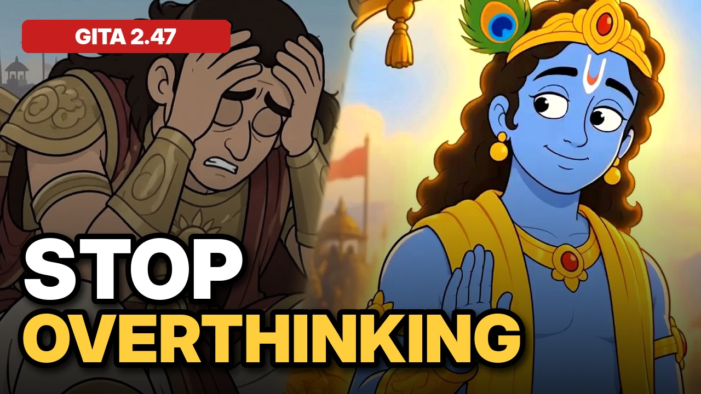
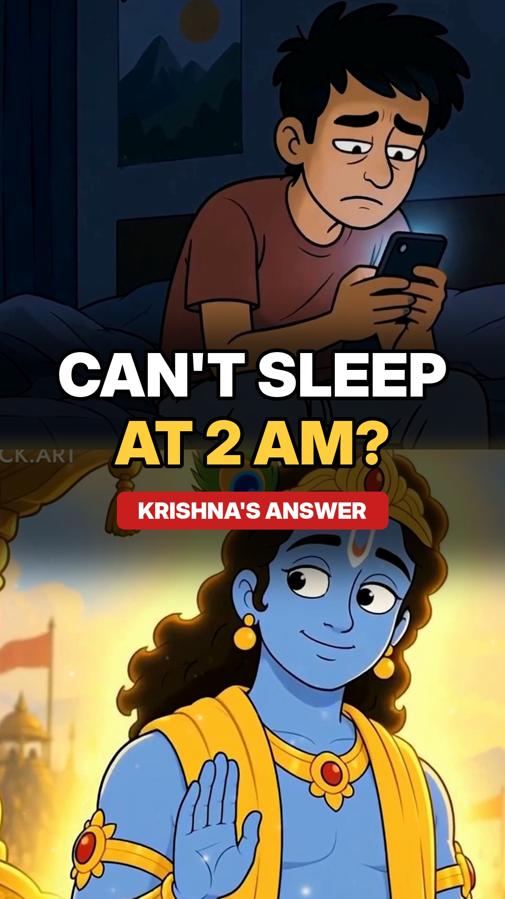
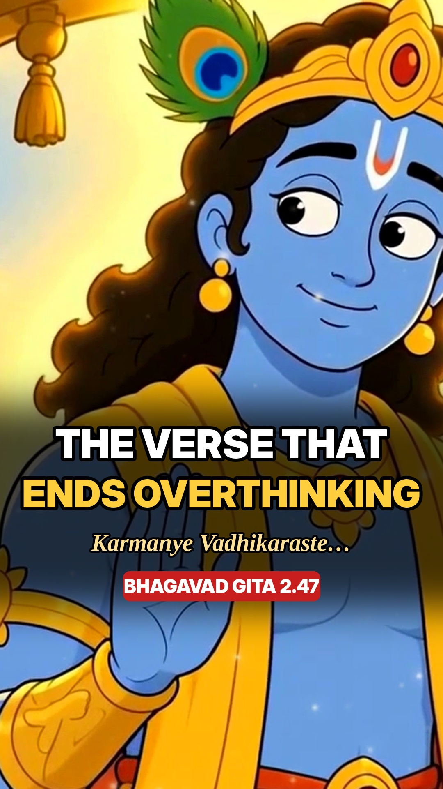
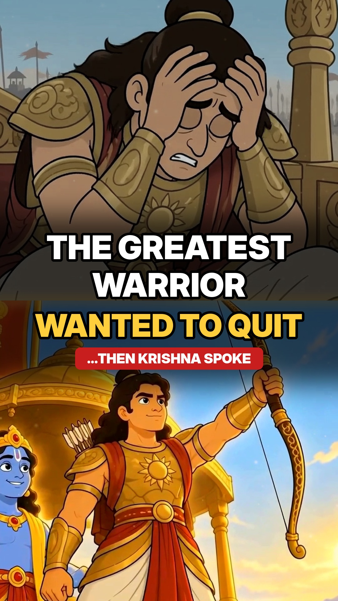

# Jaimin · Developer & AI Filmmaker

I'm a software developer who makes story-driven AI films in **[Flick](https://flick.art)**, publishes them on YouTube and Instagram, and documents what I learn in step-by-step notes.

**▶️ YouTube:** [@TheAncientTeachings](https://www.youtube.com/@TheAncientTeachings) · **📸 Instagram:** [@ancient_hinduism_wisdom](https://www.instagram.com/ancient_hinduism_wisdom/) · **📍** India, open to remote

---

## 🎬 Featured film

**[Stop Overthinking: Krishna's 5,000-Year-Old Answer (Bhagavad Gita 2.47)](https://youtu.be/VhWq9JuDmlU)** · 2:44
- Script, 12 scenes, character sheets, stills, video, AI narration, captions, sound design and thumbnail, all made by me in Flick
- About 190 Flick credits: images first, video only where a scene needed motion
- Cut into 3 vertical Reels for Instagram, each with its own hook and cover

## 📈 Channel so far (first 2 weeks)
| Video | Length | Views |
|---|---|---|
| [Stop Overthinking (Bhagavad Gita 2.47)](https://youtu.be/VhWq9JuDmlU) | 2:44 | 30 |
| [Hanuman Forgot His Own Power… (Ramayana)](https://www.youtube.com/@TheAncientTeachings/videos) | 2:35 | 11 |
| [How Mumbai Stole Its Land From the Sea](https://www.youtube.com/@TheAncientTeachings/videos) | 10:48 | 15 |

A brand-new channel with 3 subscribers. I publish every week and track what works.

## 📚 My Flick learning notes
As I learn Flick, I write each docs page up as a short note for myself: the rules, one example, a practice task, and screenshots with numbered labels showing where each button is.

**→ [Docs Walkthrough (28 guides)](flick-ai/docs-walkthrough/)**

Good places to start:
- [Generate Image](flick-ai/docs-walkthrough/14-generate-image.md) · [Image Prompts Guide](flick-ai/docs-walkthrough/16-image-prompts-guide.md)
- [Character Reference](flick-ai/docs-walkthrough/19-character-reference.md) · [Character in 3 shots](flick-ai/docs-walkthrough/20-character-three-shots.md)
- [Generate Video](flick-ai/docs-walkthrough/21-generate-video.md) · [Direct one clear action](flick-ai/docs-walkthrough/23-direct-one-clear-action.md)
- [Seedance Action Guide (fights)](flick-ai/docs-walkthrough/27-seedance-action.md)

## 📱 Short-form
|  |  |  |
|---|---|---|
| Can't sleep at 2 AM? · 38s | The verse that ends overthinking · 36s | The greatest warrior wanted to quit · 45s |

I started posting Reels on 29 Oct 2026 and passed **10,000+ views in 15 days** (as of 12 Nov 2026). Each one has a caption, hashtags and a posting checklist. Strategy: [Instagram Growth Playbook](instagram/guides/Instagram_Growth_Playbook.md).

## 🛠 How I work
1. **Brief:** one-line goal, what changes, three checks before spending credits
2. **Stills:** wide shot first, character sheets, compare images side by side
3. **Motion:** one action and one camera move per clip, check the last second
4. **Edit & publish:** cut to the voice, captions, covers, then a version per platform

## Skills
**Content:** Flick (images, video, voice, editor) · scripting & storyboards · prompting · video editing · captions · thumbnails · YouTube SEO · Instagram Reels
**Engineering:** React · Node / MERN · Python / FastAPI · Supabase · automation · Git

---

## What's in this repo
| Folder | Contents |
|---|---|
| [`flick-ai/docs-walkthrough/`](flick-ai/docs-walkthrough/) | 28 simple guides to Flick, with annotated screenshots |
| [`flick-ai/course/`](flick-ai/course/) | My 9-level learning plan and [prompt library](flick-ai/course/prompt-library.md) |
| [`flick-ai/ai-copilot/`](flick-ai/ai-copilot/) | How I split work between AI assistants and my own judgment |
| [`flick-ai/lessons/`](flick-ai/lessons/) | Notes from making the Gita film, including [my mistakes](flick-ai/lessons/09-workflow-and-mistakes.md) |
| [`flick-ai/gita-2-47/`](flick-ai/gita-2-47/) · [`flick-ai/practice/`](flick-ai/practice/) | Scripts and stills for my films |
| [`youtube/`](youtube/) | Channel setup, upload kits, thumbnails |
| [`instagram/`](instagram/) | Growth playbook, Reel kits, covers |
