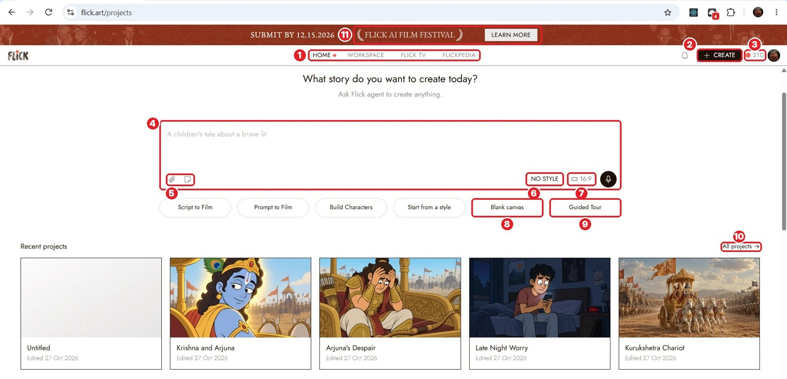
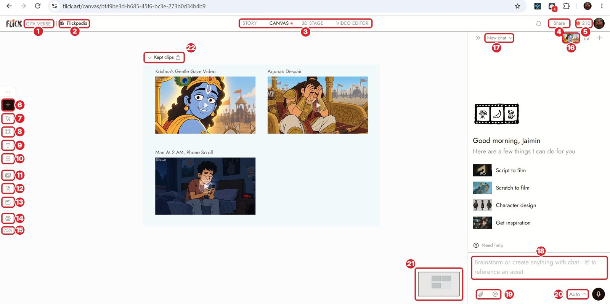
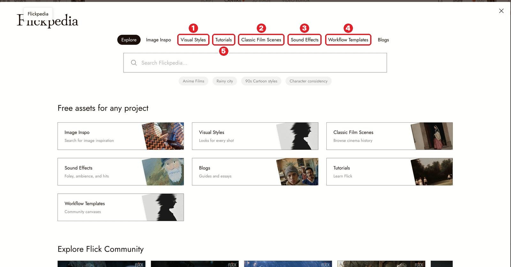
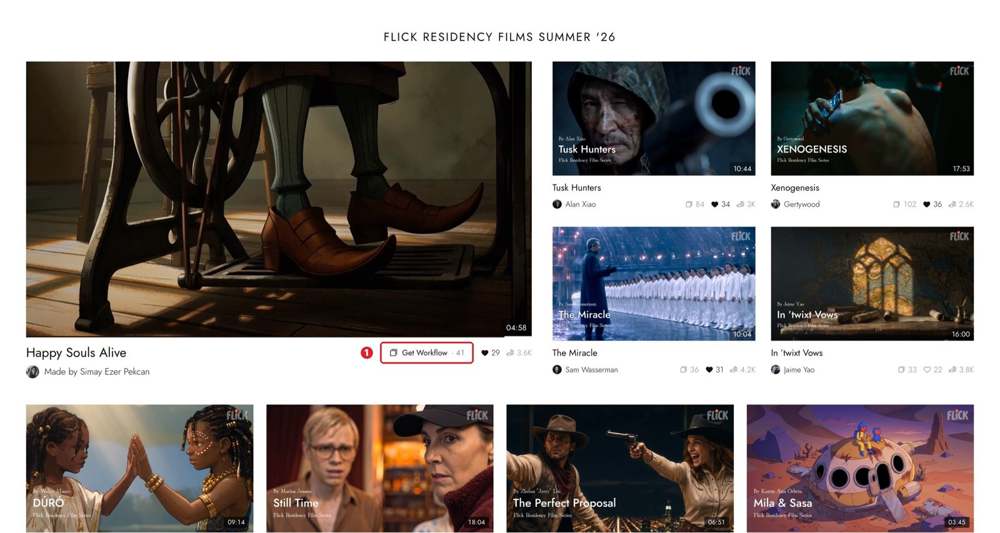

# 01 · Welcome to Flick
[Docs page](https://flick.art/docs/welcome)

Flick = one place to make a film: **Canvas** (your board), **Chat** (AI helper), **Video Editor** (timeline).

## Home page

- **8 Blank canvas**: safe way to start
- **6 NO STYLE / 7 16:9**: set the look and shape first
- **4 Prompt box**: ⚠️ typing here makes the AI start generating (costs credits)
- **3 Credits**: hover to see the breakdown

## Inside a project

- **3** Tabs: Story · Canvas · 3D Stage · Video Editor
- **6 +**: add image, video, voice, upload
- **8** Section `S` · **9** Text `T` · **11** Assets · **14** Settings
- **16** Project style · **18** Chat box (`@` = pick a node)
- **20** Approval mode → always **Manual**

## Free help
- **Flickpedia** (styles, real film shots, sounds) → 
- **Flick TV → Get Workflow**: see a pro's real canvas and prompts → 

## Rules
1. Plan → images → video → edit → export. Always in this order.
2. Change **one thing** per try.

## Practice (free)
- Do the **Guided Tour** once.
- Open one film on Flick TV → **Get Workflow** → look around.
- Set your chat to **Manual**.
