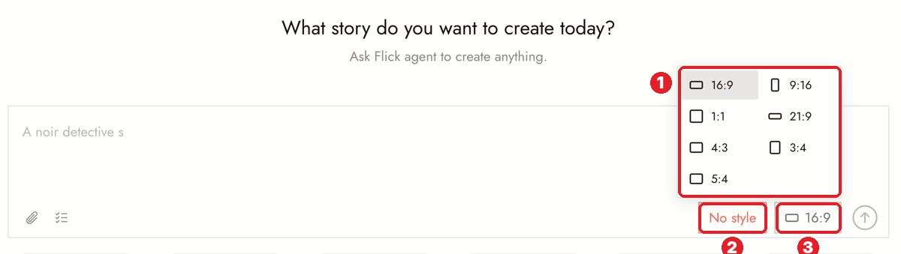
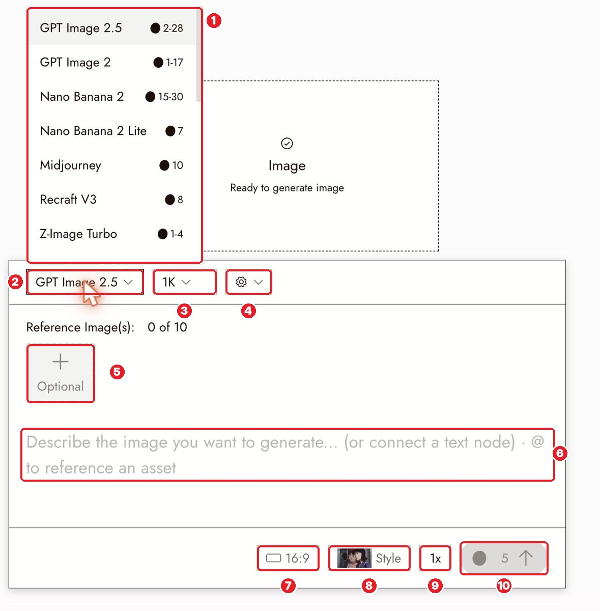
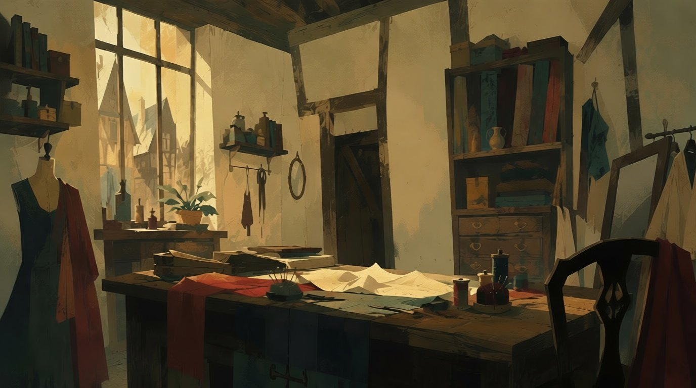

# Docs Walkthrough 02: Before You Generate

Doc: [flick.art/docs/before-you-generate](https://flick.art/docs/before-you-generate) · Full notes from earlier: [Lesson 01](../lessons/01-before-you-generate.md)

You already studied this page and used it on the Gita film, so this is a **recap + the practical bits we skipped + the AI-and-you split**.

## What to keep and what to skip
| Section | Decision |
|---|---|
| Start with what you have | ✅ New detail: two starting routes |
| One clear goal + 4-line brief | ✅ Recap: **AI writes it from your words** |
| Shape of your film (aspect ratio) | ✅ Where it is + the orange warning |
| References with a purpose | ✅ Recap + permission note |
| Choose a model | ✅ Where the picker is · details on the "Choosing a model" page |
| Check the cost | ✅ Recap |
| Decide what success looks like | ✅ New: the "empty room" first test |
| Canvas comfort | ⏭ Done in page 01 (Canvas settings, #14) |

---

## 1. Two ways to start (new)
- **From a story:** shrink it to **one moment that shows a change**. A proof of concept needs the core idea, not the whole story.
- **From a feeling, a drawing, or a look:** name what excites you (the space, the colors, the sound), then invent one small event that expresses it.

Both routes are fine. Ask: **"What should the audience understand or feel after this scene?"**

## 2. Where things are
### Aspect ratio (home page)

1. The ratio menu: 16:9 · 9:16 · 1:1 · 21:9 · 4:3 · 3:4 · 5:4
2. **No style**: pick the look first
3. The ratio button

Inside a project, new generations use the **last ratio you chose**. ⚠️ Some video models follow the source image's shape instead, and the panel tells you in **orange text**. Read it before Run.

### The Generate Image panel

| # | What | Tip |
|---|---|---|
| 1 | Model list with **credit range** | GPT Image 2.5 = 2–28 · Nano Banana 2 Lite = 7 · Z-Image Turbo = 1–4 (cheapest tests) |
| 2 | **Model** dropdown | |
| 3 | **Resolution** (1K/2K/4K) | Test at 1K |
| 4 | ⚙ extra settings for that model | Quality (low/medium/high) lives here for GPT Image |
| 5 | **Reference Image(s)** up to 10 | All are read the same way. For identity, use **Character Reference** instead |
| 6 | Prompt (or connect a **text node**) | `@` references another asset |
| 7 | Aspect ratio | |
| 8 | **Style** (project style) | Don't add style words to the prompt |
| 9 | **1x** batch count | Cost multiplies |
| 10 | **Run + cost** | Check every time |

## 3. References: one rule we skipped
Use only material you own or have permission to use, and **keep its source** with your project (a text note on the canvas is enough).

## 4. The "empty room" first test (new and very practical)

The *Happy Souls Alive* team tested the **room first, with no character in it**. It passed 2 of 3 checks (it reads as a working shop, the sewing machine is easy to find) and failed one (nobody is there to notice anything yet). That's a **good** first test: settle the place cheaply, then add the character.

➡ For every new location: **1 empty-room image → check → then add people.**

---

## 🧠 AI + You on this page
| AI does | You do |
|---|---|
| Turns your 3–5 lines into goal, brief, success checks, project bible ([Master prompt 1](../ai-copilot/README.md#1-directors-brief--project-bible)) | Decide **the one moment** and **what changes** |
| Suggests aspect ratio and format for your platform | Decide where the film lives (YouTube vs Reels) |
| Lists possible references | **Find the real ones** (Classic Film Scenes, photos) and pick |
| Writes the empty-room prompt | Judge whether the place feels true |

## ✅ Practice (~10 credits)
1. Pick your next lesson film idea. Write **3–5 lines in your own words** (don't polish).
2. Paste them into **Master prompt 1** (Claude or ChatGPT) → get your project bible.
3. **Edit it yourself:** fix anything culturally wrong, add one detail only you know.
4. In Flick: Blank canvas → paste the bible into **Project memory**.
5. Generate **one empty-room image** of the main location (Z-Image Turbo or GPT Image 2.5 low), and check it against your 3 checks.

**Next page:** Create Your First Project.
