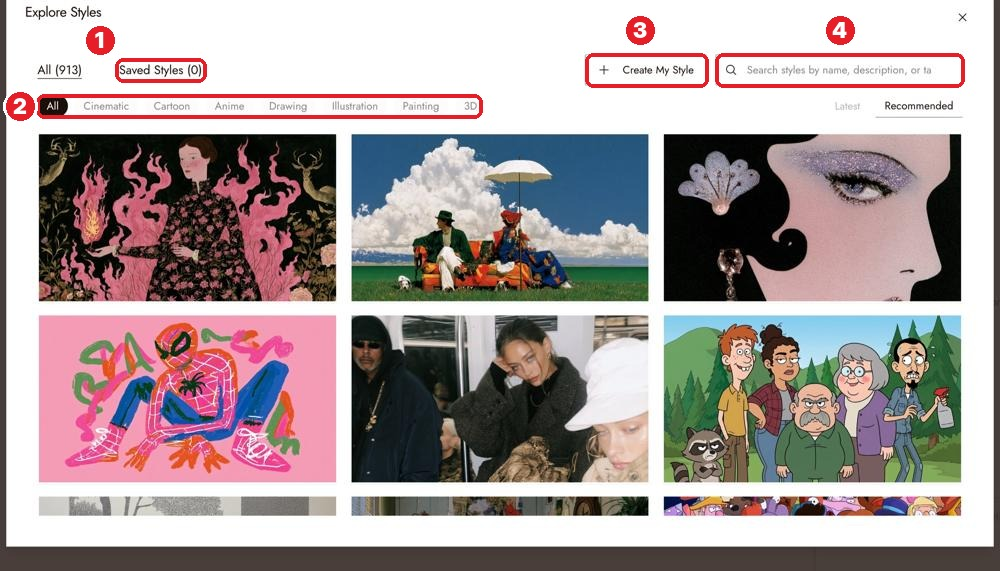
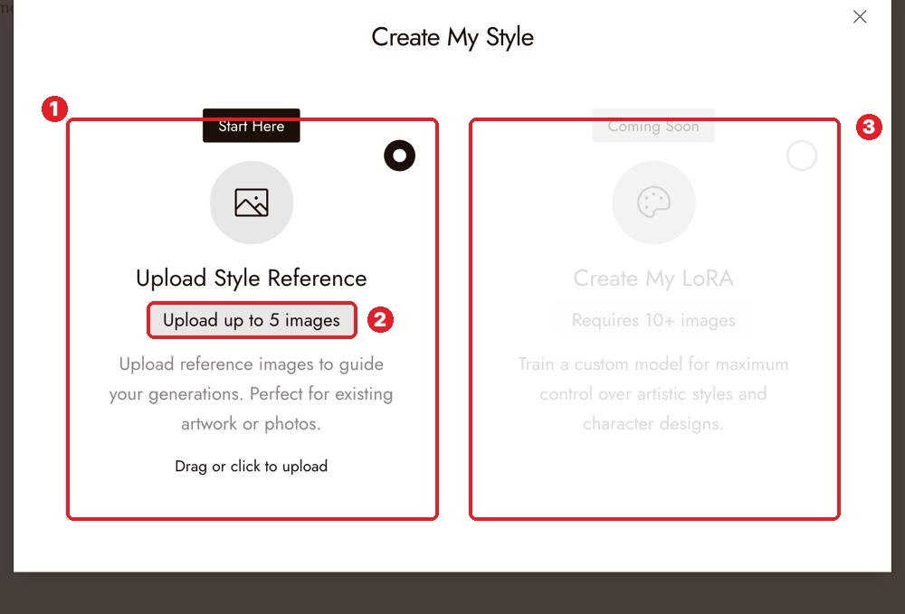
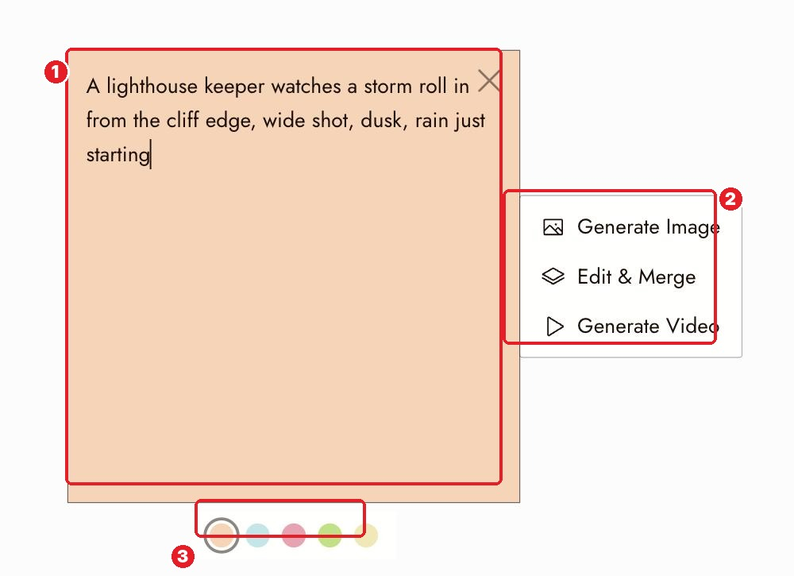
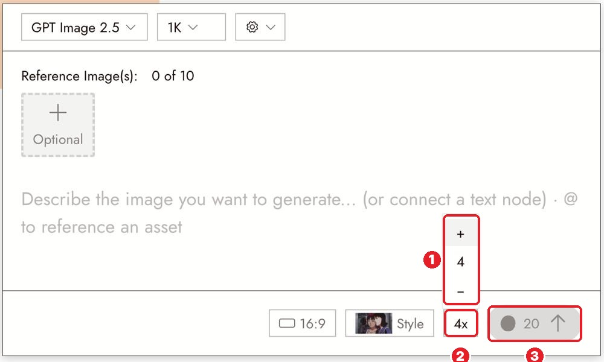
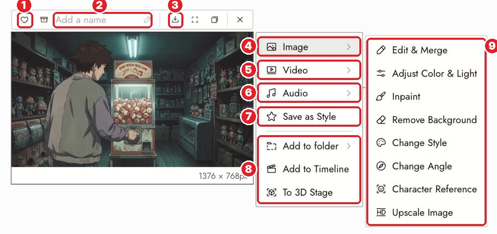
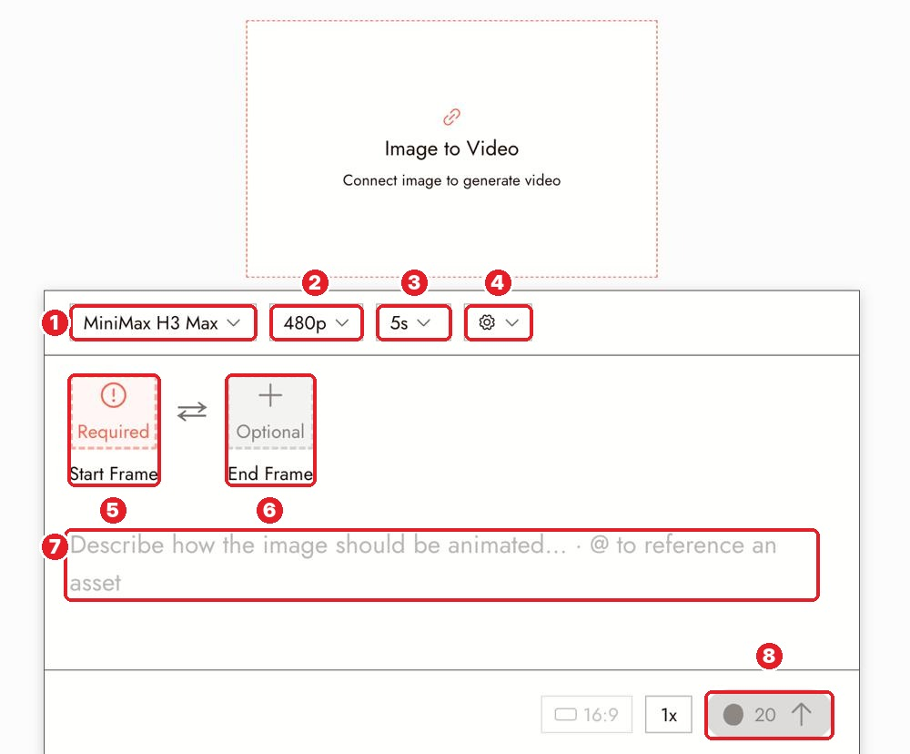

# Docs Walkthrough 03: Create Your First Project

Doc: [flick.art/docs/create-your-first-project](https://flick.art/docs/create-your-first-project)

This page is a **tour of the whole toolbox**. Learn **where everything is** now; each tool gets its own page later.

## What to keep and what to skip
| Step on the page | Decision |
|---|---|
| 1. Create a project | ✅ Recap (Blank canvas) |
| 2. Style and aspect ratio | ✅ **Explore Styles + Create My Style** |
| 3. Generate your first image | ✅ Recap |
| 4. Text nodes for prompts | ✅ **New, and a pro habit** |
| 5. Image variations (batch) | ✅ **New** |
| 6. Edit images | 🗺 Map only now · full page: *Edit Image* |
| 7. Change style | 🗺 Map only · full page: *Visual Styles* |
| 8. Generate a video | ✅ Done on the Gita film · full page: *Generate Video* |
| 9. Classic film shots | ✅ Short · full page: *Classic Film Scenes* |
| 10. Flick TV | ⏭ Done in page 01 |
| "Create My LoRA" | ⏭ Skip: "Coming Soon" |

---

## 1. Start a project
Home → **Blank canvas** (or **+ CREATE** in the top bar). A new canvas shows **"Get inspo or type/speak"**: Get inspo opens Flickpedia; the hint disappears after your first node.

## 2. Pick the look first

Click **NO STYLE** (home prompt box) or the **style thumbnail at the top of the chat panel** (inside a project).

| # | What |
|---|---|
| 1 | **Saved Styles**: your own styles live here |
| 2 | Categories: Cinematic, Cartoon, Anime, Drawing, Illustration, Painting, 3D |
| 3 | **Create My Style** |
| 4 | Search by name, description or tag |

1. **Upload Style Reference**: your own look from images
2. **Upload up to 5 images** that show the look plainly (light, palette, texture)
3. ⏭ *Create My LoRA*: coming soon

💡 **Pro move:** once one image has the perfect look, use its menu → **Save as Style** (see section 5) and use that for every shot.

## 3. Text nodes: prompts that live on the canvas

| # | What |
|---|---|
| 1 | A **text node** (press `T`). Write the prompt here |
| 2 | Its menu: **Generate Image · Edit & Merge · Generate Video**. The text becomes the prompt automatically |
| 3 | **Color** of the note |

Click **Disconnect** on the panel to stop using a note as the prompt.

**Why pros use them:**
- Every prompt stays **visible and editable** on the canvas. Change a word, run again, and compare.
- **Color-code** them: 🟠 image prompts · 🔵 motion prompts · 🩷 notes/feedback · 🟢 approved · 🟡 to-do
- When you share with **Get Workflow**, others learn from your prompts (like we did with "The Duel").

## 4. Batch: compare variations

1. Click **1x** to open the counter (up to 4)
2. **4x**
3. The **cost multiplies**: 5 → **20** credits

Use batches to choose **between options for one shot**, from a clear prompt. Ten images from a vague prompt teach you nothing.

## 5. The image menu: your toolbox map

Select any image to see:

| # | What | Learn it on page |
|---|---|---|
| 1 | ♡ **Favorite**: shows in Assets → Favorites | Find your generations |
| 2 | **Name** the node (the agent and `@` use names) | |
| 3 | **Download** | |
| 4 | **Image ›** opens the editing tools (9) | |
| 5 | **Video ›**: Generate Video, Omni Reference, Character Dialogue, Motion Reference | Generate Video, Omni Reference |
| 6 | **Audio ›**: Generate Voice for this character | Text to Voice |
| 7 | **Save as Style** | Visual Styles |
| 8 | Add to folder · **Add to Timeline** · **To 3D Stage** | Sections and folders, Timeline, 3D Stage |
| 9 | **Edit & Merge · Adjust Color & Light · Inpaint · Remove Background · Change Style · Change Angle · Character Reference · Upscale Image** | Edit Image, Camera Control, Character Reference |

## 6. Video panel (recap)

1. Model · 2. Resolution · 3. Duration · 4. ⚙ extra settings · 5. **Start Frame (required)** · 6. **End Frame (optional)** · 7. Motion prompt · 8. Run + cost

Start it **from the image** (image menu → Video → Generate Video), so the Start Frame fills in automatically.

## 7. Classic film shots (short)
Top bar **Flickpedia → Classic Film Scenes** → search a film → pick a shot → **Add to Canvas**. Then select it and ask the chat to **summarize the composition** or **generate a similar image in your style**.

---

## 🧠 AI + You on this page
| AI does | You do |
|---|---|
| Writes one prompt per shot → you paste each into its own **text node** ([Master prompt 3](../ai-copilot/README.md#3-image-prompt-writer-nano-banana-pro--gpt-image)) | Choose the style from **real references**, and decide the color code |
| Describes a Classic Film shot in camera language ([Master prompt 6](../ai-copilot/README.md#6-reference-analyzer-steal-like-a-director)) | Pick the shot that matches your story's feeling |
| Scores 4 variations against your checks ([Master prompt 7](../ai-copilot/README.md#7-result-critic)) | **Pick the one.** ♡ it, name it, Save as Style |

## ✅ Practice (~15 credits)
1. **Blank canvas** → name it *"Practice: Lesson 3"* → set **Manual** in chat.
2. **Create My Style** from 3–5 images you love (or pick one in Explore Styles).
3. Press `T` → write a prompt (or get one from Master prompt 3) → make it 🟠 → **Generate Image** → GPT Image 2.5 low → **4x** (8 credits).
4. Pick the best one: ♡ **Favorite**, **name** it, **Save as Style**.
5. Flickpedia → **Classic Film Scenes** → **Add to Canvas** one shot you like → ask the chat: *"Summarize the composition of this shot: shot size, angle, lens, light."*
6. Open the image menu → **Image ›** and just look at the 8 tools (don't run them yet).

**Next page:** [04 Tell a small story in three shots](04-three-shot-story.md)
