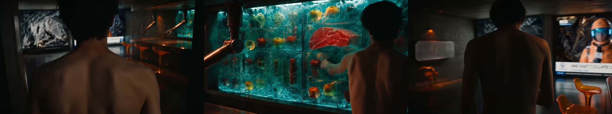
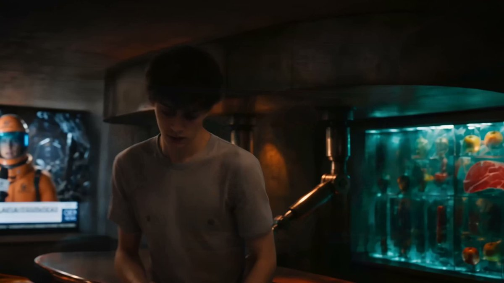
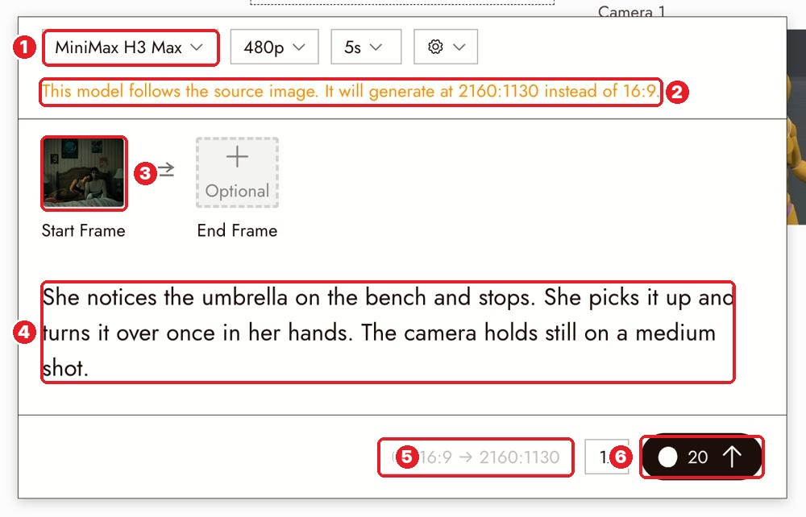
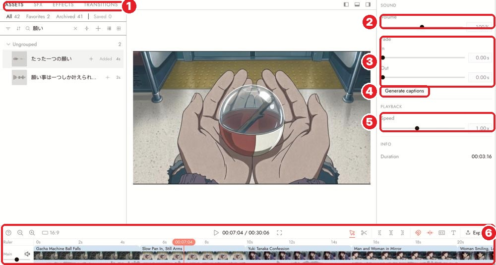

# Docs Walkthrough 04: Tell a Small Story in Three Shots

Doc: [flick.art/docs/your-first-three-shot-film](https://flick.art/docs/your-first-three-shot-film)

This is the **whole filmmaking loop in miniature**: plan → stills → motion → edit → sound → export. You did all of it on the Gita film, so here we keep only the **director's ideas** that make a short film work, plus the screens.

## What to keep and what to skip
| Section | Decision |
|---|---|
| 1. Give each shot a job | ✅ **The core idea of this page** |
| 2. Visual direction | ✅ Short (you know it) |
| 3. A still for each shot | ✅ **New: reject beautiful shots that break continuity** |
| 4. Simple motion | ✅ **New: "tell it with the edit"** + the orange warning |
| 5. Timeline | ✅ **New: test the cut earlier/later** |
| 6. Sound | ✅ Short · full page: *Build the sound* |
| 7. Review and export | ⏭ Full page later: *Export and download your film* |
| Make another version | ✅ One line |

---

## 1. Every shot has ONE job
A short film needs **a change the audience can follow**: one person, one place, one small action, about **10–15 seconds**.

| Shot | Job | Example (umbrella story) |
|---|---|---|
| 1 | **Establish**: where are we, who is here | Wide: the empty platform and bench |
| 2 | **Notice**: point attention at the important thing | Closer: the red umbrella beside the bench |
| 3 | **Resolve**: show the result of a choice | The umbrella on the bench as the traveler leaves |

💡 **You don't have to show every movement.** Cut from "she notices" straight to "the umbrella is on the bench". The viewer fills in the pickup, and you skip the hardest shot to generate.

*Xenogenesis kitchen: alone in the room → reaching into the fridge → with the apple.* These **three shots came from one kept clip**: one good generation, cut into three. That's a pro money-saver (see "AI + You").

## 2. Stills: judge the sequence, not the single image
- Make the **establishing shot first**. It decides the place, light and character for everything after.
- Put the three stills **side by side** and compare.
- **Reject a beautiful shot** if the umbrella changes shape or the station stops matching.

*Rejected:* a T-shirt and a phone appeared that weren't in the start frame. The shot looked fine on its own, but it **didn't match the shot before it**.

## 3. Motion: behavior, not emotion

| # | What |
|---|---|
| 1 | Model |
| 2 | ⚠️ **Orange warning**: "This model follows the source image. It will generate at 2160:1130 instead of 16:9." Fix the still's shape first if that's wrong for your film |
| 3 | Start Frame |
| 4 | Motion prompt: what she does, then what the camera does |
| 5 | Ratio actually used: **16:9 → 2160:1130** |
| 6 | Run + cost |

- Write **visible behavior**: not "act kindly" but "the traveler notices the umbrella and pauses".
- Check the **start and the end** of every clip for changes to the character, object or background.
- **If an action won't generate reliably, tell it with the edit**: show the umbrella before and after it was moved.

## 4. Edit: test where the cut lands

| # | What |
|---|---|
| 1 | Left panel tabs: **ASSETS · SFX · EFFECTS · TRANSITIONS** |
| 2 | **Volume** of the selected clip |
| 3 | **Fade in / out** |
| 4 | **Generate captions** |
| 5 | **Speed** |
| 6 | Toolbar + **Main** track with clips in order |

- **Trim anything that adds no information.**
- Hold the key detail (the umbrella) **long enough to notice**, about 1.5–2 seconds, then cut.
- **Try the cut earlier, then later.** Keep the version where the choice reads clearest.
- Start with **straight cuts**. Add a transition only if it means something (time passing, a new place).

## 5. Sound gives the place a feeling
Try a quiet station ambience or soft footsteps. **Watch once with sound and once without.** Does the sound help the place feel real, or add an event the picture doesn't show? Music is optional.

## 6. Make another version
Same three jobs, new world: a forgotten book in a café, a dropped scarf at a bus stop. Keep it small enough to **finish**.

---

## 🧠 AI + You on this page
| AI does | You do |
|---|---|
| Turns your idea into a 3-shot table: jobs, sizes, angles, prompts ([Master prompt 2](../ai-copilot/README.md#2-shot-list-designer)) | Decide **the change**, and which movement to *skip* and tell with a cut |
| Writes the 3 image prompts and 3 motion prompts | Put the stills side by side and **reject what breaks continuity** |
| Lists continuity risks per shot (props, clothes, light) | Feel the cut: earlier or later? |
| Suggests ambience and SFX | Watch with and without sound and decide |

**🔥 Pro trick: "one take, many shots"**
Instead of 3 separate clips, generate **one longer clip with 3 beats** in order (first… then… then…), then **cut it into 3 shots** in the editor, like Xenogenesis did and like "The Duel" did inside one 30-second Seedance take. One generation means one look, one character, one light: perfect continuity, and often cheaper than three clips plus retries.

## ✅ Practice: a 10–15 second film (~70–100 credits)
1. Write a 1-sentence story with **a change** (or use one of the page's examples).
2. **Master prompt 2** → 3-shot table. Fix it: is each job clear? Can you skip the hardest movement?
3. **Shot 1 (establish)** still first → approve → then shots 2 and 3, using shot 1 as the location reference.
4. Put all 3 stills side by side. Reject anything that breaks continuity.
5. Animate (MiniMax H3 Fast or Seedance 2.5 Draft). Check the **first and last second** of each.
6. Editor: order → trim → test the cut earlier and later → add one ambience track → watch with and without sound.

**Next page:** Navigation (canvas controls). It's short, and we covered most of it on page 01.
