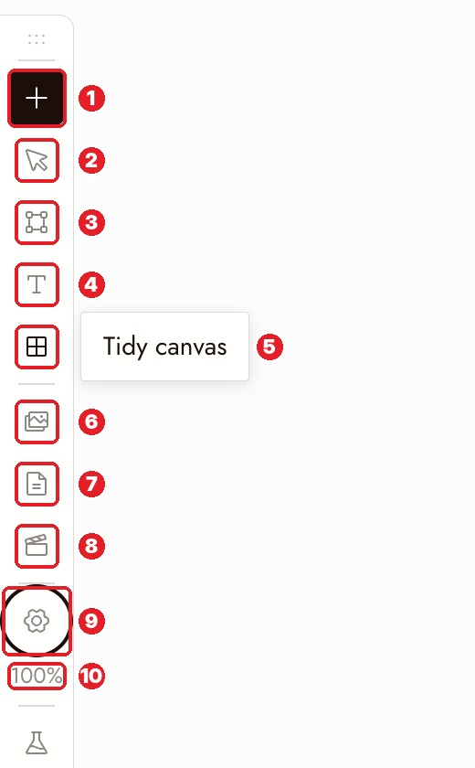
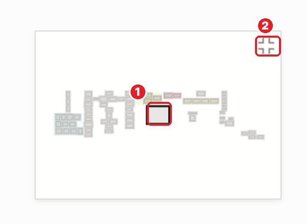

# 05 · Navigation
[Docs page](https://flick.art/docs/navigation)

How to move around the canvas fast.

## Left toolbar

**1** + add · **2** select / hand · **3** section `S` · **4** text `T` · **5** tidy canvas · **6** assets · **7** story · **8** video editor · **9** settings · **10** zoom

## Mouse
| Do this | How |
|---|---|
| Move the board | Right-click + drag, or middle mouse |
| Zoom | `Ctrl/⌘` + scroll, or pinch |
| Select many | Drag on empty canvas (box select) |
| Connect nodes | Drag from a node's **+** to another node |

## Shortcuts
| Key | Does |
|---|---|
| `Enter` | ⚠️ **Runs** selected nodes (costs credits) |
| `Backspace` | Deletes selected |
| `⌘/Ctrl + C / V` | Copy / paste (also pastes images from your clipboard) |
| `⌘/Ctrl + 1` | Fit whole canvas on screen |
| `⌘/Ctrl + 0` | 100% zoom |
| `⌘/Ctrl + Z` | Undo |
| `S` / `T` | New section / text note |

## Minimap

**1** the frame = what's on screen. Click anywhere to jump there. **2** hide it (turn it back on in Settings).

## Tidy canvas
Toolbar **5** lines up everything neatly. One `⌘Z` undoes it. To tidy just part, select it → **Tidy up**.

## Rules
1. **Check what's selected before `Enter` or `Backspace`.**
2. **Lost something? Press `⌘1`.**
3. **Zoom out before judging an image.** Judge it next to the other shots.

## Practice (free)
In any project: box-select a group → move it → `⌘1` → click the minimap → Tidy canvas → `⌘Z`.
