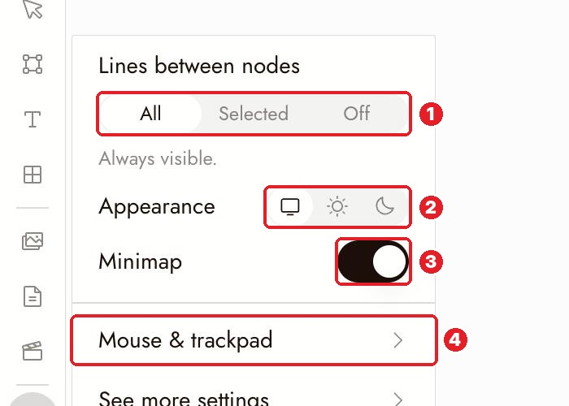
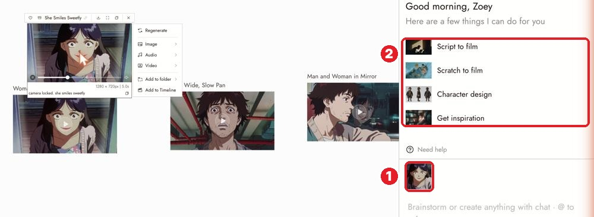
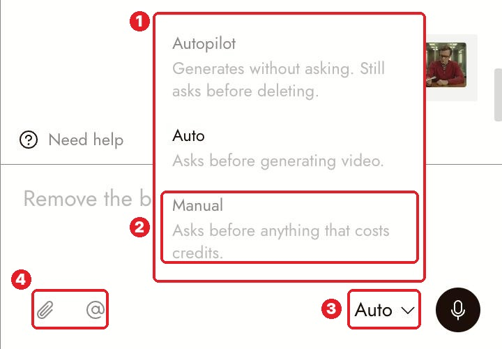
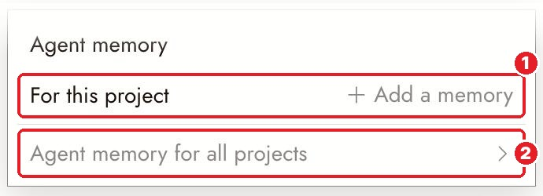
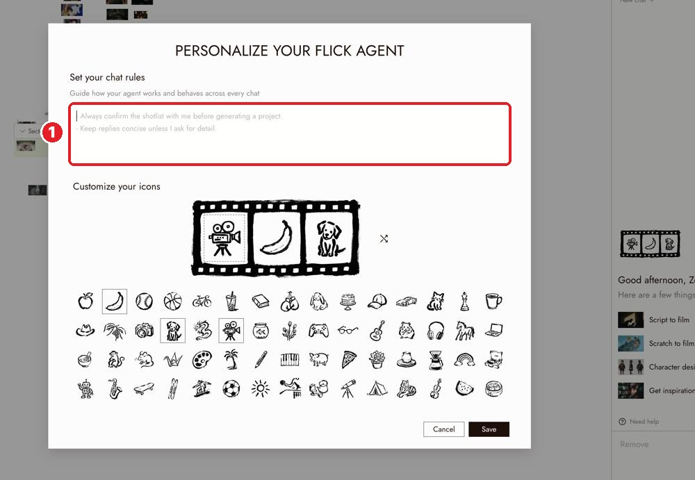

# 06 · Canvas Settings + Talking to the Agent
Docs: [Canvas settings](https://flick.art/docs/canvas-settings) · [Talking to the agent](https://flick.art/docs/talking-to-the-agent)

## Canvas settings (gear icon on the left toolbar)

**1** lines between nodes: All / Selected / **Off** (Off = cleaner view to compare images) · **2** light / dark · **3** minimap on/off · **4** **Scroll to zoom** (turn off if scrolling zooms by mistake)

These only change your view, never your images.

---

## The agent (chat on the right)
It can **generate**, **organize** (name, make sections) and **edit the timeline** (trim, speed, volume, fades, captions) for you. It can't see your screen: only what you **select** or **attach**.

**1** the selected node shows above the chat box. That's what the agent looks at. **2** quick-start ideas.

### Approval mode: set it once

**3** click the mode → **2 Manual** = asks before anything that costs credits. **4** 📎 attach · `@` pick a node.

### Memory: tell it the rules once

Chat header → **Agent memory**: **1** this project (style, character rules) · **2** all projects.

**Personalize** → **1** chat rules for every chat, e.g. *"Always show the cost and ask before generating."*

## Rules
1. **Select the node first**, then ask.
2. **Name it:** "the wide shot in the Station section", not "that one".
3. **Change one thing, say what stays:** "Same character, same framing, make the coat red."
4. **Say "keep / change / because"** instead of "try again":
   > Keep the empty station. Change the storm to soft light, because I want it calm.
5. **Ask for ideas without spending:** add *"Don't generate anything yet."*
6. **Read its report** after every action.

## Practice (free)
- Set **Manual**.
- Add a project memory: your style + one character rule.
- Personalize: *"Always show the cost and ask before generating."*
- Select an image → ask: *"Name this node 'Hero wide shot' and put it in a section called 'Scene 1'."*
