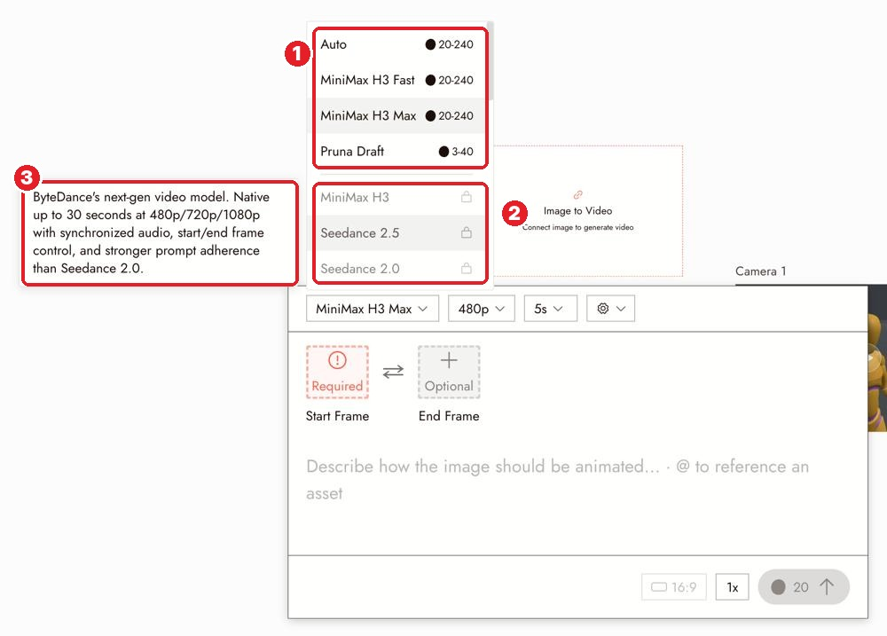

# 07 · What Flick Can Do (and Its Limits)
[Docs page](https://flick.art/docs/what-flick-can-do)

Your **menu of tools**. Find the tool for the job here, then learn it on its own page.

## Images (image menu → Image ›)
| I want to… | Use |
|---|---|
| Make an image | Generate Image |
| Change one thing / merge images | Edit & Merge |
| Fix one area | Inpaint |
| Cut out the subject | Remove Background |
| Same image, new look | Change Style |
| Same shot, new camera angle | Change Angle |
| Same character, new scene | Character Reference |
| Better color or light, no regenerating | Adjust Color & Light |
| Bigger / sharper | Upscale |

## Video (image menu → Video ›)
| I want to… | Use |
|---|---|
| Animate a still | Generate Video (Frame to Video) |
| Control the look, motion and camera with references | Omni Reference |
| Copy movement from a video | Motion Reference |
| A character talking | Character Dialogue |
| Make a clip longer | Extend Video (Standard plan+) |
| Keep part of a clip, free | Trim on canvas |
| Plan the camera move exactly | 3D Stage |

## Audio
Voice (one or many speakers) · same voice for a character · sound effects · music.
Free sounds: **Flickpedia → Sound Effects** or the editor's **SFX** tab.

## Limits

**1** models + credit range · **2** 🔒 = needs a paid plan · **3** **hover a model** to see its max length, resolutions and audio support

## Rules
1. **One clip has a max length.** A long film = many clips on the timeline.
2. **Video costs much more than images.** Fix the image first.
3. **Flagged by moderation = it doesn't run.** Change the prompt; switching models won't get around it.
4. **Hover before you choose a model.**

## Practice (free)
Open a video panel → hover 3 models → write down each one's max length, resolution and audio.
