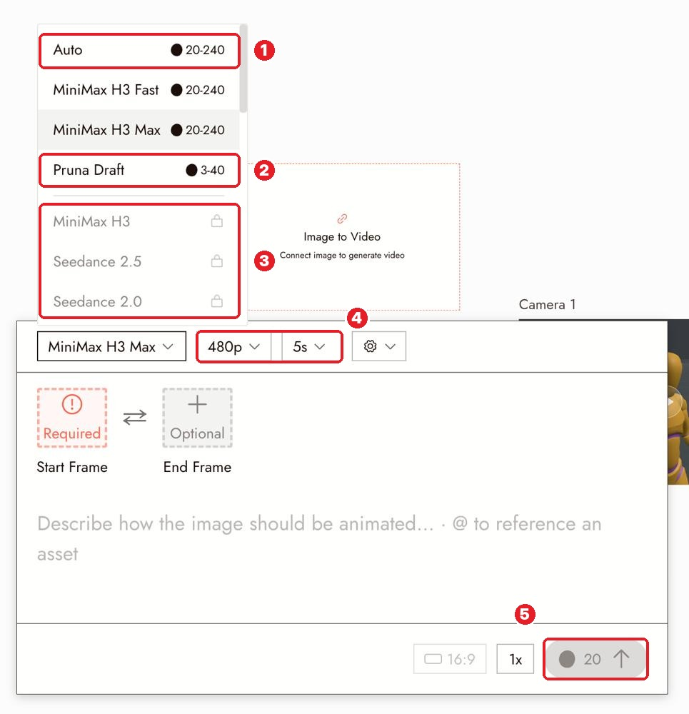

# 08 · Choosing a Model
[Docs page](https://flick.art/docs/choosing-a-model) · Costs: [Model Credit Costs](https://flick.art/docs/model-credit-cost)

There's no "best" model. Pick by the **job** and the **budget**.

## Where it is

**1** **Auto**: lets Flick choose (good for a first video test) · **2** **Draft** models: cheap tests · **3** 🔒 needs a paid plan · **4** resolution and length change the price · **5** exact cost

## Quick picks
| Job | Test with (cheap) | Final with |
|---|---|---|
| Image | Z-Image Turbo (1–4) · GPT Image 2.5 low (2) | **Nano Banana Pro** (30) · GPT Image 2.5 high (10) |
| Same character in new scenes | Nano Banana 2 Lite (7) | **Nano Banana Pro** |
| Video, simple motion | **Auto** · Pruna Draft (3–40) · MiniMax H3 Fast (20) | MiniMax H3 Max · Kling 3.0 |
| Acting, dialogue, action, up to 30s with sound | **Seedance 2.5 Draft** (~21/s) | **Seedance 2.5** (~48/s) |
| Make a clip longer | Wan 3.0 at 480p | Wan 3.0 at 720p (12/s) |

*Prices change. Always check the Run button.*

## Hover tells you
Max length · audio yes/no · start/end frame · resolutions · cost range.

## Rules
1. **Draft first, final model last.** Once the shot works, change only the model.
2. **Compare fairly:** same image, same prompt, same length.
3. **One model per scene**, so characters don't change between shots.
4. **Keep a note:** "Seedance = best for fights", "MiniMax = fine for slow pushes".
5. **Locked or missing model?** 🔒 = plan. Missing = you picked the wrong action (Image vs Video).

## Practice (~45 credits)
Same still, same prompt, 5s: run **Pruna Draft** vs **MiniMax H3 Fast**. Which keeps the face better? Write it down.
