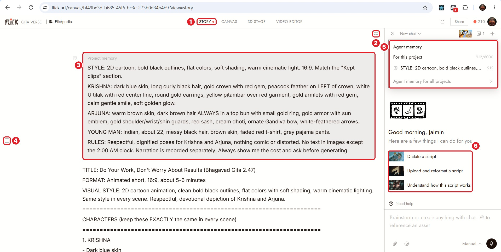
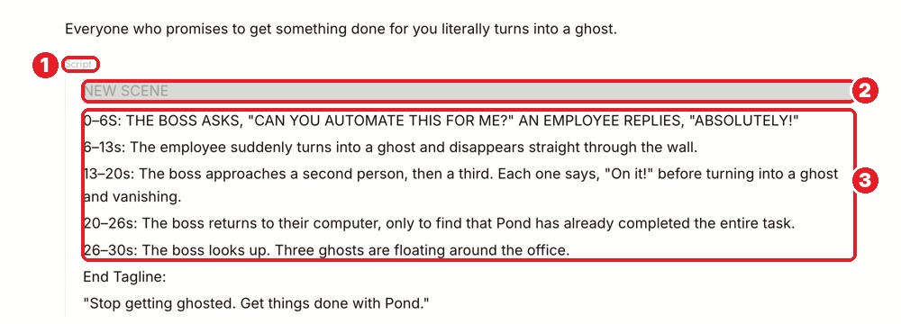
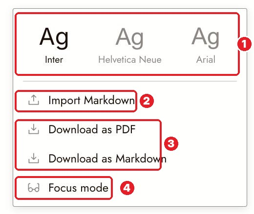

# 09 · Story (Your Script Page)
[Docs page](https://flick.art/docs/script-view-basics)

**Story = your project's notebook.** Script, notes, character rules, all in one page. You and the agent both write here.

## Where it is

**1** **STORY** tab (or the Story button on the canvas toolbar) · **2** document menu · **3** **Project memory** card · **4** outline (hover to jump to a scene) · **5** Agent memory · **6** quick help from the agent

## 1. Write
Type `/` to add a block: heading, list, table, **Script**, **Project memory**.
Shortcuts: `#` heading · `-` list · `1.` numbered list

## 2. Script box (for screenplays)

**1** script box · **2** scene line · **3** action lines
- `Enter` = next line (Flick guesses the type)
- `Tab` = change the line type (Scene, Action, Character, Dialogue…)
- Start a line with `INT.` or `EXT.` = new scene

## 3. Bring in your script
| You have | Do |
|---|---|
| Notes or text (like your Gita script) | **Paste** with `Ctrl+V` |
| A real screenplay file (.fountain, .fdx, .pdf, .docx) | Script box → **Upload** |
| A Markdown file | Document menu → **Import Markdown** |

## 4. Project memory: the most important card
The agent reads it **every message**. Put:
- the style recipe
- each character's look
- rules ("no text in images", "ask before generating")

**Keep it short.** There's a limit (8000 characters).

## 5. Document menu

**1** font · **2** Import Markdown · **3** download as PDF / Markdown · **4** Focus mode (`Esc` to leave)

## Rules
1. **Write the brief and memory before generating anything.**
2. **One character = one spelling.** "Arjuna" and "Arjun" become 2 characters.
3. **Ask the agent to help:** "draft scene 2", "make a table of characters", "rename X to Y everywhere".
4. **The agent keeps forgetting your style?** Put it in Project memory, not in chat.

## AI + You
- **AI:** drafts scenes, tightens lines, makes the character table.
- **You:** decide what happens and what each scene must make the viewer feel.

## Practice (free)
Open **STORY** → paste a short idea → type `/` → add **Project memory** with your style + 1 character → ask the agent: *"Make a table of the characters in this story. Don't generate anything."*
