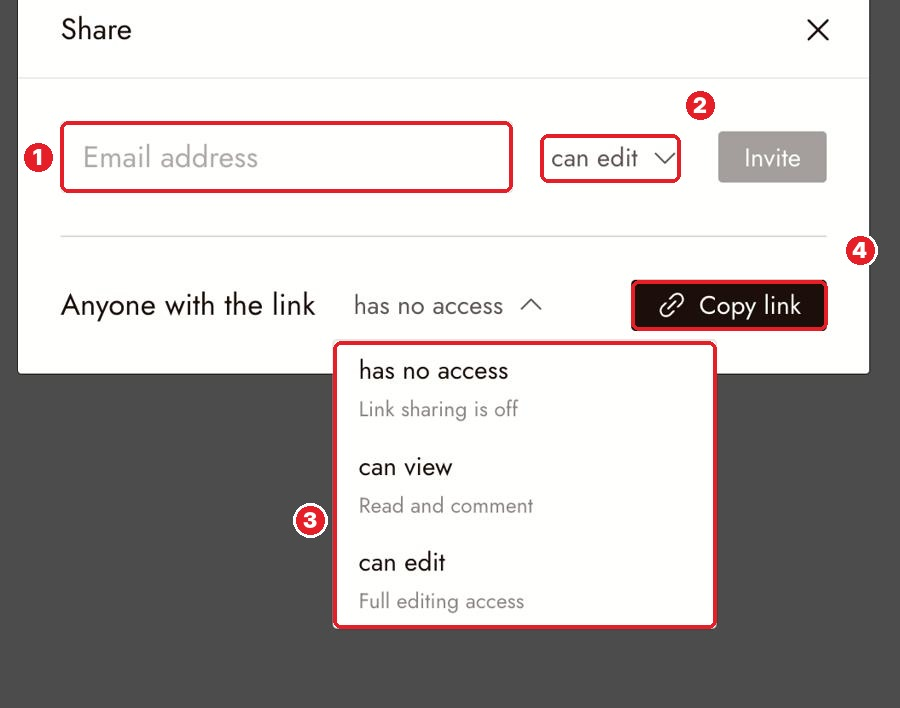
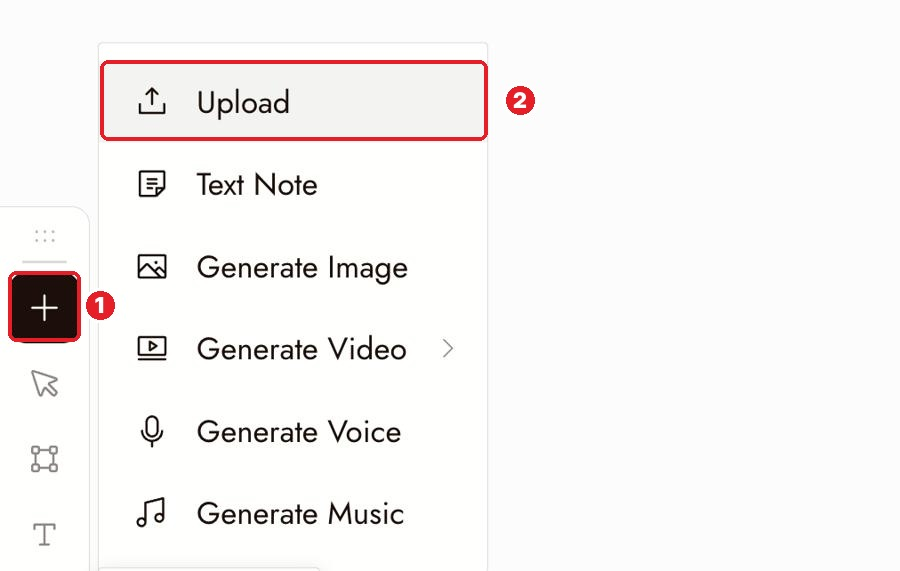

# 10 · Share + Upload
Docs: [Collaboration & Share](https://flick.art/docs/collaborationandshare) · [Upload and import](https://flick.art/docs/upload-and-import)

## Share a project
Click **Share** (top right of the canvas).

**1** email · **2** can edit / can view → **Invite** · **3** link access · **4** Copy link

| Link setting | Means |
|---|---|
| has no access | Link is off (default) |
| **can view** | Can watch and comment. Use this for reviewers |
| can edit | Can change everything. Only for people you trust |

**Publish to Flick TV** = for finished films, from the export screen. ⚠️ It also shares your prompts (workflow) unless you turn that off.

## Upload your files

**1** + → **2** Upload. Images, video and audio all become nodes.

Faster ways:
- **Copy any image → `Ctrl+V`** on the canvas
- **Drag several images** in at once → Flick puts them in a section called "Reference Images"
- **📎 in chat** = give the agent a file without putting it on the canvas

## Rules
1. **Reviewers get "can view", not "can edit".**
2. **Only upload what you own** or have permission to use.
3. **Can't find the upload?** Press `Ctrl+1`.
4. **Agent can't see your image?** Select it, or attach it in chat.

## Practice (free)
Copy a photo from your browser → `Ctrl+V` on the canvas. Then Share → can view → Copy link → open it in a private window.
