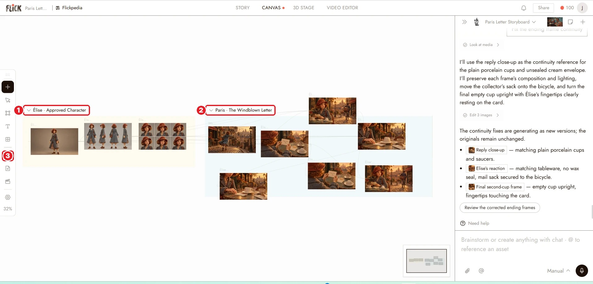
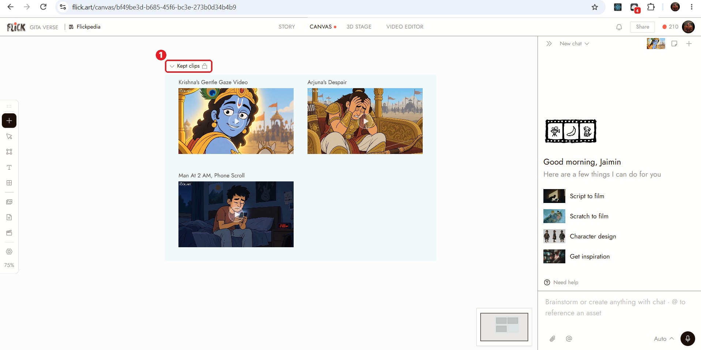
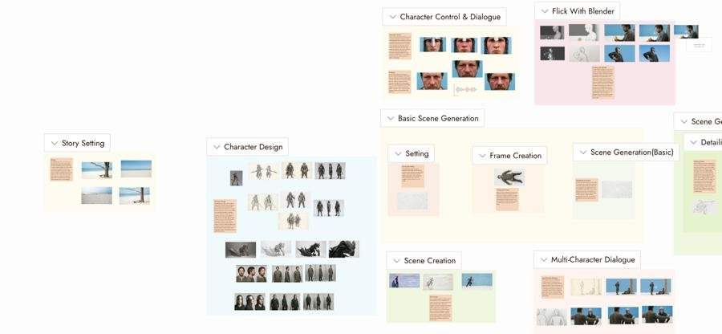

# 11 · Workspaces + Sections and Folders
Docs: [Workspaces](https://flick.art/docs/workspaces) · [Sections and folders](https://flick.art/docs/sections-and-folders)

## Workspaces (only if you work in a team)
You already have a **personal workspace**. You don't need to make one.

| | Team member | Guest |
|---|---|---|
| Sees | All shared projects | Only the one project shared with them |
| Credits | The team's pool (owner pays) | — |
| How | Account Center → **Team** → invite by email | **Share** button on a project |

New projects start **Private**. To share one with your team, use the icon next to the zoom control.

⏭ Solo creator? Skip this part for now.

---

## Sections: boxes that group nodes on the canvas

Your Paris project already uses them well: **1** "Élise · Approved Character" · **2** "Paris · The Windblown Letter" · **3** Assets (folders live here)

**Make a section:**
- Select nodes → **Create section** (toolbar above the selection), or
- Press `S` and draw a box, or
- Ask the agent: *"Put these three in a section called Scene 1."*

**Lock it** when it's finished:

**1** 🔒 beside the name = nothing new can land inside, and nothing moves.

A good canvas looks like this, one section per job:

## Folders: for finding things later
Select a node → **Add to folder** → open **Assets** to browse. The Video Editor sees the same folders.

| You want to… | Use |
|---|---|
| Keep a character's sheets together | **Section** + 🔒 lock |
| Separate scene 1 from scene 2 | One **section per scene** |
| Keep your best takes easy to find | **Folder** in Assets |
| Tell the agent which images you mean | A **named section**, then mention its name |

## Rules
1. **Name every section clearly:** "S1 Rooftop", not "Section 3". The agent and `@` use these names.
2. **Lock finished sections.** Otherwise new generations land inside and mix things up.
3. **One section per scene + one for characters.**
4. **Collapse sections** you're not working on (the ˅ arrow) to keep the canvas clean.

## Practice (free)
In The Last Diya: select S1, S2, S3 → **Create section** → name it "Stills" → lock it. Then the 3 videos → "Videos". Add your final film to a folder called "Finals".
