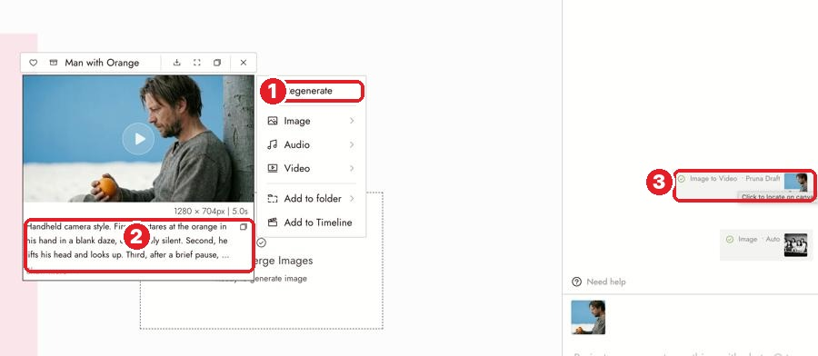
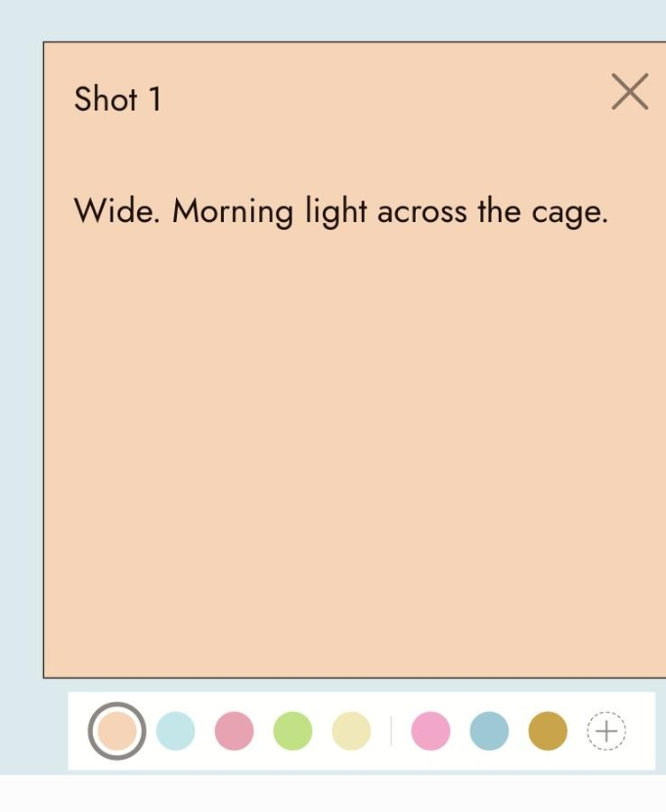

# 12 · Find Your Generations + Text Nodes + Colors
Docs: [Find your generations](https://flick.art/docs/find-your-generations) · [Text Nodes](https://flick.art/docs/text-nodes) · [Colors](https://flick.art/docs/colors)

## Can't find a result?
Check in this order:
1. **Still running?** Look at the node: pending → processing → done. Video takes minutes.
2. **Off screen?** Press `Ctrl+1`. The result sits next to the node it came from.
3. **Failed?** The node shows a message. Flagged → change the prompt. Error → retry once.
4. Still missing? **Assets** (left toolbar) → also check **Archived**.


**1** **Regenerate** (same settings, new try) · **2** the prompt used, saved under every result · **3** the chat's report: click a result to jump to it on the canvas

⚠️ Clicking Run twice = 2 generations = 2 charges.

## Text nodes: one per shot
Press `T` → write the prompt → **Generate Image**. The image stays connected to the note.
- Edit the text → **run again**. It doesn't rerun by itself.
- **Disconnect** = stop the image following this note.

**Write each note as one shot:**
```
Shot 1 — Wide. Morning light across the cage.
Subject: …   Action: …   Setting: …   Framing: …
```
For the next shot, copy the note and change only what's different.

## Colors

Select a note or section → **1** 5 presets · **2** your last 5 custom colors · **3** **+** pick any color

**My color code:**
| Color | Means |
|---|---|
| 🟠 Orange | Image prompt |
| 🔵 Blue | Motion prompt |
| 🩷 Pink | Notes / feedback |
| 🟢 Green | Approved ✓ |
| 🟡 Yellow | To fix |

Or **one color per scene**: color the section and its notes the same, so they read as one group.

## Rules
1. **Lost a result? `Ctrl+1` first, then Assets.**
2. **Never click Run twice** while waiting.
3. **One text note per shot.** Easier to fix than scrolling the chat.
4. **Same color system in every project.**

## Practice (free)
In The Last Diya: make 3 orange notes (one image prompt per shot) and 3 blue notes (the motion prompts). Turn the notes of the approved shots green.
