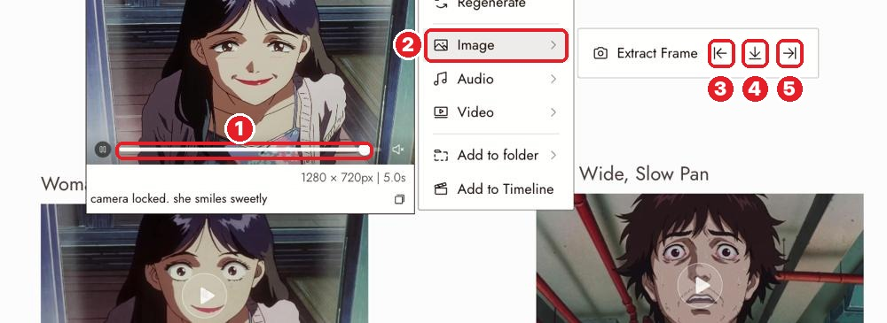

# 13 · Extract Frame
[Docs page](https://flick.art/docs/extractframe)

Save one frame of a video as an image. **Free.**

## Where it is

Select a video → **1** drag the slider to the moment you want → **2** **Image ›** → **Extract Frame**:
**3** first frame · **4** this frame (slider position) · **5** last frame

The frame appears as a new image node, connected to the video.

## Use it for
| Goal | Take | Then |
|---|---|---|
| **Continue a clip** (next shot starts where this one ends) | **Last frame** | Use it as the Start Frame of the next video |
| **Make a reference** (character sheet, location) | The **clearest** frame | Character Reference / Edit & Merge |
| **3D Stage take** | **First frame** | Render it, then Omni Reference *(covered later)* |

You already did this on the Gita film: Arjuna's, Krishna's and the boy's sheets came from extracted frames.

## Rules
1. **Pick a still moment.** Motion blur stays in the image.
2. **Continuing a clip? Use the last frame,** but check the cut. It isn't always seamless.
3. **Wrong frame?** Move the slider and extract again, then delete the extra node.
4. **Can't find it?** It's under **Image ›** in the video's menu, not in the top bar.

## Practice (free)
Take V2 from The Last Diya → **Last frame** → you now have an image of the lit diya, ready to start a new shot from.
