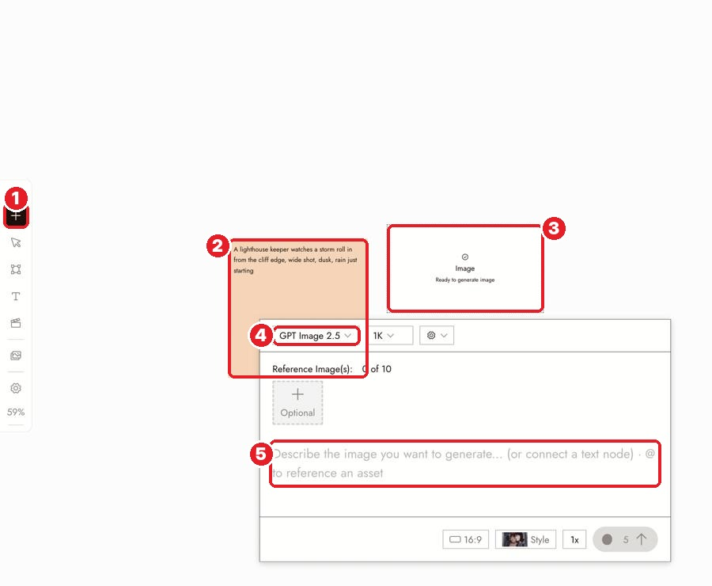

# 14 · Generate Image
[Docs page](https://flick.art/docs/generate-image) · Prompt guide: [Image Generation Prompts](https://flick.art/docs/Image-Generation-prompts)

## Where it is

**1** **+ → Generate Image** · **2** a text note as the prompt (optional) · **3** the image node · **4** model · **5** prompt (`@` = use another asset)
Panel buttons: [see page 02](02-before-you-generate.md#where-things-are).

Or just ask the chat: *"Generate an image of…"*

## The prompt formula
**Subject → Action → Setting → Framing → Light**

| ❌ Weak | ✅ Strong |
|---|---|
| cool cinematic scene with a lot going on | a woman in a mustard raincoat waiting on an empty station platform after rain, wide shot, soft daylight |
| sad old man | an old man sits alone on a bench, head lowered, hands folded, medium shot, grey morning light |
| oil painting, anime, photorealistic *(with a style already set)* | *(no style words, only content)* |

## Which model
| Test (cheap) | Final |
|---|---|
| GPT Image 2.5 low (2) · Z-Image Turbo (1–4) | **Nano Banana Pro** (30) · GPT Image 2.5 high (10) |

## Rules
1. **One clear subject per image.** Put it in the first words.
2. **No style words** when a project style is set.
3. **Say the framing:** wide / medium / close-up.
4. **Small batch from a clear prompt** beats 10 images from a vague one.
5. **Change one thing** between tries (framing *or* light, not the whole prompt).

## Check every image
- [ ] One clear subject, the right number of things
- [ ] The framing you asked for
- [ ] Matches the project style
- [ ] No extra fingers, broken objects, or random text
- [ ] It would fit next to your other shots

## If it's wrong
| Problem | Fix |
|---|---|
| Subject missing | Move it to the first words |
| Wrong look | Check the style at the top of the chat; remove style words |
| All tries look the same | Change one thing: framing or light |
| Nothing appeared | Check the node status; `Ctrl+1` |

## Practice (~10 credits, GPT Image 2.5 low)
Same subject, 3 prompts:
1. **Weak:** `a sage meditating, cinematic`
2. **Strong:** `An old sage with a white beard in a saffron robe sits cross-legged on a rock beside a Himalayan river at dawn, eyes closed. Wide shot. Soft golden light from behind the mountains.`
3. **One change:** same as 2, but `Close-up of his face.`

Then run #2 at **4x**. Compare: what changed, and why?
