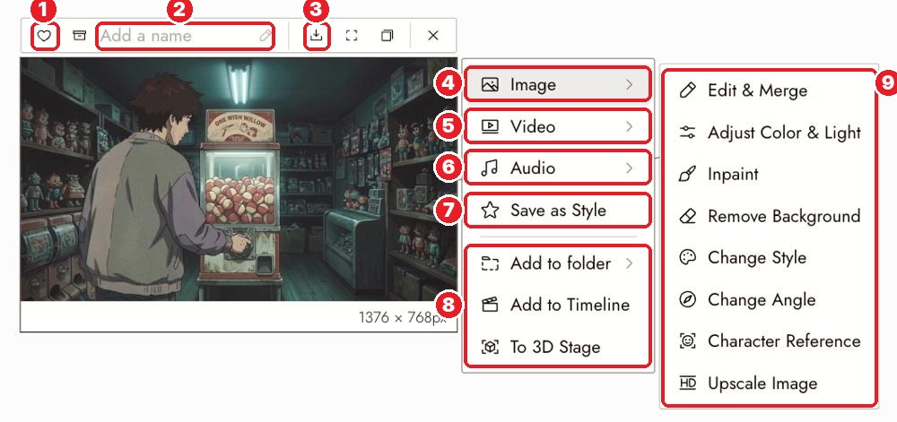

# 15 · Edit Image
[Docs page](https://flick.art/docs/editimage)

Change **one thing** in an image you like, instead of making a new one.

## Where it is

Select the image → **4 Image ›** → **9** the tools:

| Tool | Use it when | Example |
|---|---|---|
| **Edit & Merge** | Change one thing, or combine images | "Change the coat to red" · "Put the boy from image 1 on the rooftop from image 2" |
| **Inpaint** | Fix one **area** only (you paint over it) | Fix a broken hand, remove a stray object |
| **Adjust Color & Light** | Brighter, warmer, more contrast, **no new generation** | Make the dusk a bit darker |
| **Remove Background** | Cut out the subject | Use a character on a new background |
| **Change Style** | Same picture, new look | Cartoon → watercolor *(next page)* |
| **Upscale** | Bigger and sharper | Final image before video |

Or select the image and type the change in the **chat**.

## The edit prompt formula
```
Edit the provided base image.
Keep the composition, camera position and framing unchanged.
Only change [one thing].
```
Example: *"…Only change the boy's kurta from yellow to red."*

## Rules
1. **Name the change, not the picture.** ❌ "make it better" ✅ "change the raincoat to red; keep everything else"
2. **One change per edit.** Then the next one.
3. **Say what stays:** "same character, same framing, replace the station with a café."
4. **Small area wrong? Inpaint**, not a full edit.
5. **Only color or light wrong? Adjust Color & Light.** It's cheaper, and nothing else changes.

## Check
- [ ] Only the thing you named changed
- [ ] The face still matches
- [ ] Light still makes sense
- [ ] Hands, edges and any text survived

## If it's wrong
| Problem | Fix |
|---|---|
| The whole image changed | Add "keep everything else unchanged"; one edit at a time |
| The face changed | Add the character sheet as a reference too |
| The edit was ignored | Simplify the request; it may fight the pinned style |

## Practice (~10 credits)
Take **S1 Wide** from The Last Diya:
1. Edit & Merge → *"Only change the boy's kurta to deep red."*
2. Adjust Color & Light → make the sky a little darker.
Compare both with the original: did anything else change?
