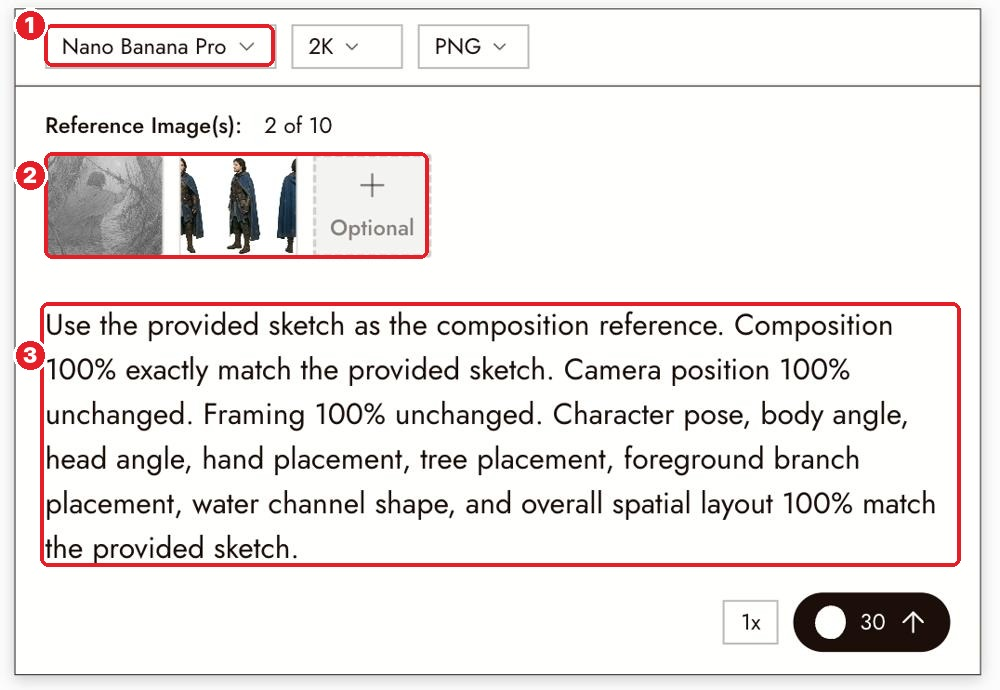
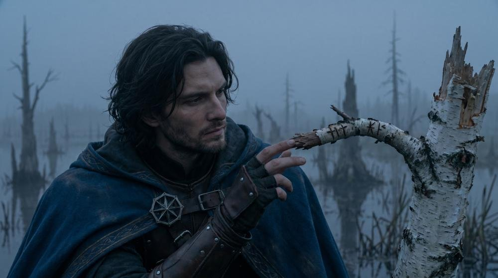
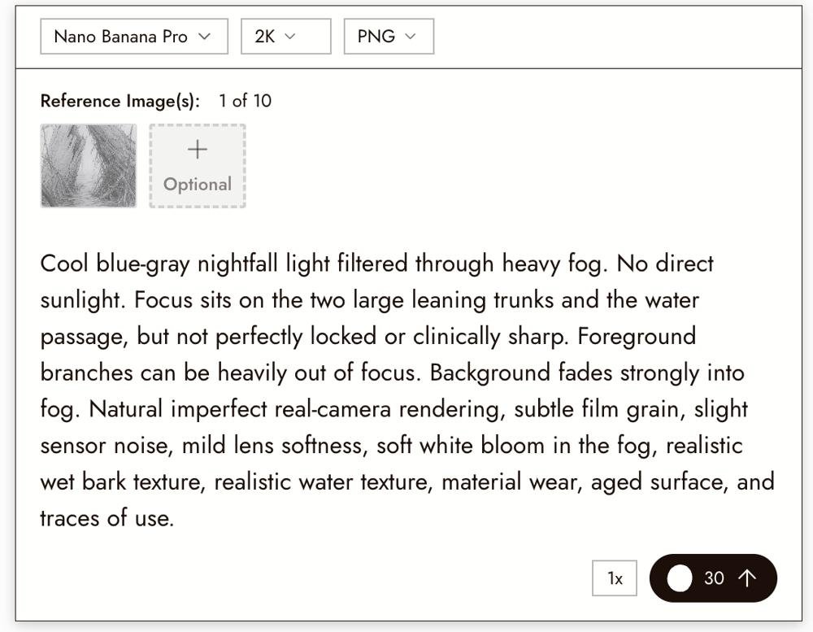
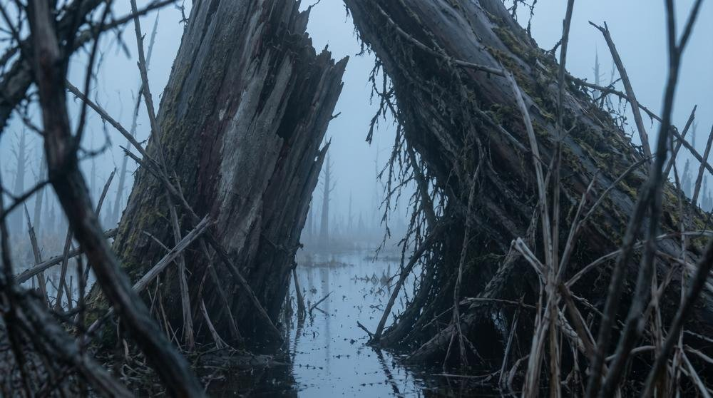

# 16 · Image Prompts Guide (the most useful page)
[Docs page](https://flick.art/docs/Image-Generation-prompts)

For **Nano Banana** and **GPT Image**, when you use references.

## Rule 1: The reference carries the look. The prompt carries the change.
Don't describe the face or costume again. Say **keep**, then say **what changes**.
```
Keep the facial identity, structure, features and expression from the provided character reference.
Keep the hairstyle, outfit design and colors from the provided character reference.
[Now only the new scene, pose, light.]
```

## Rule 2: Give every reference one job

**1** Nano Banana Pro · **2** two references: a **sketch** (layout) + a **character sheet** (who) · **3** the prompt says which one does what

```
Use the provided sketch for composition, framing, camera position and pose.
Use the provided character reference for facial identity.
```
Short labels: *the provided sketch · the provided character reference · the provided base image*

Result: the sketch's exact layout with the sheet's exact person.


## Rule 3: Lock words work
`composition 100% match the provided sketch` · `camera position 100% unchanged` · `facial identity 100% match the provided character reference`

## Rule 4: Describe light, not mood

❌ "cinematic, moody"
✅ "Cool blue-gray nightfall light filtered through heavy fog. No direct sunlight."

Say: **where the light comes from · which areas are bright · which are dark · what's in focus.**


## Quick do / don't
| ❌ Don't | ✅ Do |
|---|---|
| "on his left side" | "on the side facing the window" (models confuse left/right) |
| "no glass" | "an open window, mist drifting through" (say what IS there) |
| "maybe a sword or spear" | "a long spear" (pick one) |
| "make it like before" | Attach the earlier image as a reference |
| Long prompts repeating the reference | Short: keep + change |

## Focus (for realistic images)
`focus on the character's face` · `foreground heavily out of focus` · `background softly blurred`

## Texture (pick 1–3, only if it fits)
`subtle film grain` · `mild lens softness` · `realistic skin texture` · `realistic fabric texture` · `aged surface, use marks`

## Edit template
```
Edit the provided base image.
Keep the composition, camera position and framing unchanged.
Only change [one thing].
```

## Practice (~20 credits)
1. Draw a quick **stick sketch** on paper (a figure by a tree), photo it, upload it.
2. Add any character sheet (e.g. **Arjuna Sheet**).
3. Prompt: *"Use the provided sketch for composition, framing, camera position and pose. Use the provided character reference for facial identity and costume. Cool misty dawn light from behind; his face in soft shade."*
4. Model: Nano Banana 2 Lite (7) to test, then Nano Banana Pro if you like it.

Does the pose match your sketch **and** the face match the sheet?
