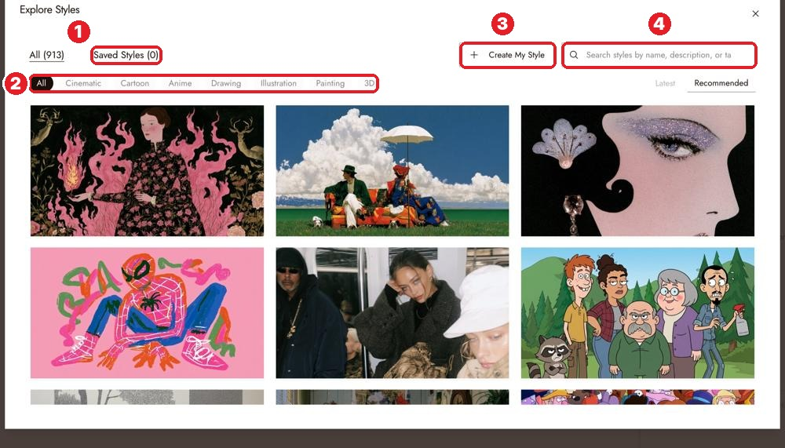
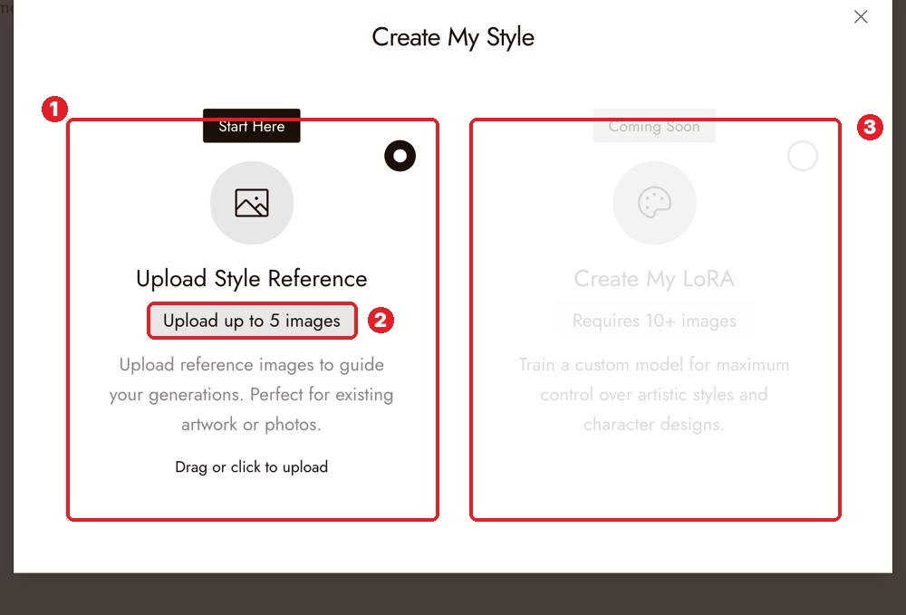
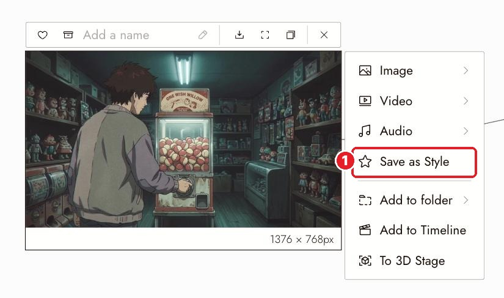

# 17 · Visual Styles
[Docs page](https://flick.art/docs/visual-styles)

The **style** sets the look: colors, lines, light, texture. Set it **once** and every new image follows it.

## 3 ways to get a style
**A. Pick one** (1,000+): **NO STYLE** button on home, or the style thumbnail at the top of the chat.

**2** categories (Cinematic, Cartoon, Anime, 3D…) · **4** search

**B. Make your own** from up to 5 images: **3 Create My Style → Upload Style Reference**

**C. Save a perfect image as a style** (best!)

Select the image → **1 Save as Style** → find it in **Saved Styles**.

## Change the style of an existing image
Image menu → **Image › Change Style** → pick a style → Run. Then check the character and angle didn't change.

## Rules
1. **Pick the style before the first shot.** Changing it later doesn't restyle old images.
2. **Style goes in the style button, content goes in the prompt.** No "anime, oil painting" words in prompts.
3. **Your style images should show the look clearly:** plain light, clear colors, simple scene. A busy scene makes a bad style source.
4. **Got one perfect frame? Save as Style** and use it for the whole scene.

## Check
- [ ] Every shot looks like the same film
- [ ] The look works for a wide shot **and** a close-up
- [ ] The style doesn't hide the subject

## If it's wrong
| Problem | Fix |
|---|---|
| Style drifts between shots | Check the project style didn't change |
| Style is too strong | Simplify the prompt, or pick a softer style |
| Saved style looks wrong | Use a simpler source image |

## Practice (~10 credits)
In The Last Diya: select **S1 Wide → Save as Style**. Then make a new image *"the boy carrying a plate of sweets down the stairs"* with that style. Does it look like the same film?
