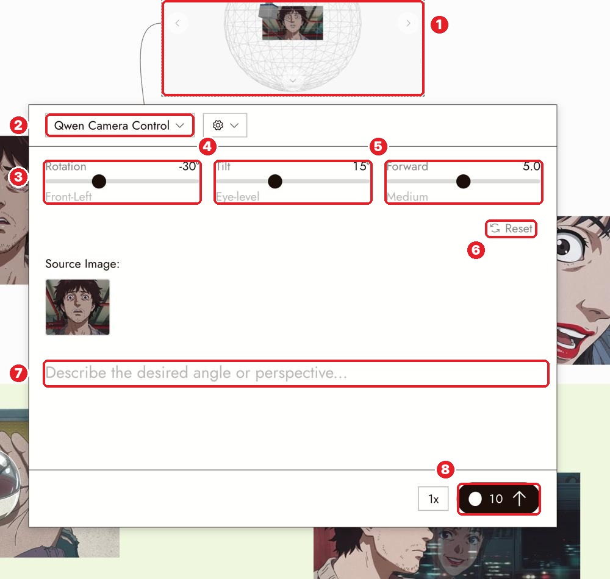

# 18 · Camera Control (new angle of the same shot)
[Docs page](https://flick.art/docs/camera-control)

Move the camera **around** your image: same person, same place, new angle.
Use it for **reverse shots** and **reaction shots** that cut together.

## Where it is
Select the image → **Image › Change Angle**

**1** sphere preview of the camera · **2** model (Qwen Camera Control) · **3** **Rotation** (around the subject) · **4** **Tilt** (up / down) · **5** **Forward** (closer / farther) · **6** Reset · **7** prompt (optional) · **8** cost (~10)

## Sliders in plain words
| Slider | Minus | Plus | Example use |
|---|---|---|---|
| Rotation | move to one side | move to the other side | Side view of a face |
| Tilt | look up at them (low angle, power) | look down on them (high angle, smaller) | Hero shot |
| Forward | farther (wider) | closer | From medium to close-up |

## Rules
1. **Small moves first** (e.g. Rotation 15–30°). Big moves make the AI invent what it can't see.
2. **Say the framing you want** in the prompt: "medium shot". Moving closer isn't a crop.
3. **Start from a clear image with depth.** A flat picture gives the AI nothing to rotate.
4. **Face changed?** Fix the identity first with Character Reference, then change the angle.

## Check
- [ ] Same person, same clothes, same light direction
- [ ] The new background looks believable
- [ ] The framing is what you asked for

## Practice (~10 credits)
Take **S3 Lit** from The Last Diya → Change Angle → **Rotation 30°, Tilt 15°** → prompt: *"medium shot of the boy from the side, looking at the glowing diyas."* Would it cut nicely after S3?
