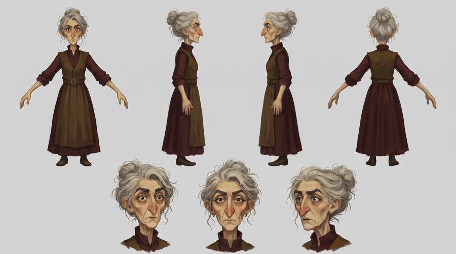
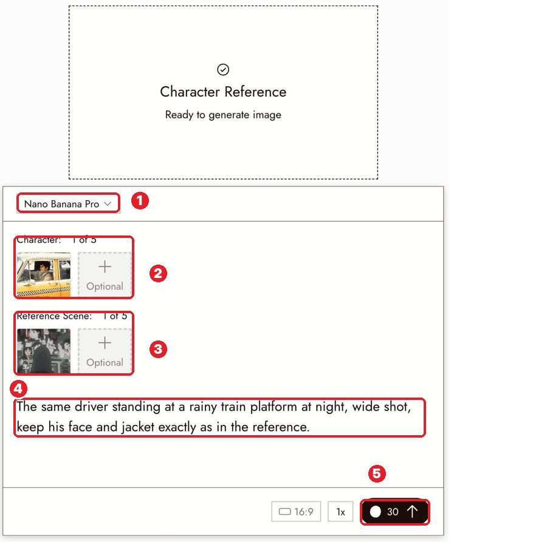
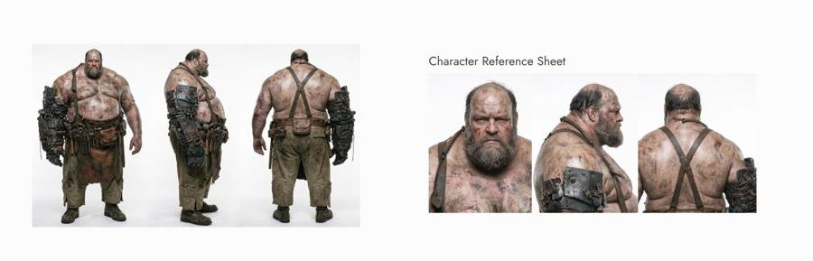

# 19 · Character Reference
[Docs page](https://flick.art/docs/character-reference) · Practice page: [Keep a character consistent across three shots](https://flick.art/docs/character-consistency-three-shots)

Keep **the same person** in every shot. Make a reference sheet once, reuse it everywhere.

## Step 1: Make a character sheet
Ask the chat: *"Create a three-view character sheet of [description]. Front, side, three-quarter. Plain background. Use Nano Banana Pro."*
Or extract a good frame from a video ([page 13](13-extract-frame.md)) and ask for a sheet from it.


A pro sheet: 4 body views + 3 face expressions, plain background.

**Then:** put it in a section named after the character → 🔒 lock it.

## Step 2: Put the character in a scene
Select the sheet → **Image › Character Reference**

**1** model · **2** **Character** (up to 5: sheet + a face close-up) · **3** **Reference Scene** (up to 5, optional: the place) · **4** prompt · **5** cost

**Prompt = only the change:**
```
The same driver standing at a rainy train platform at night, wide shot.
Keep his face and jacket exactly as in the reference.
```

## Need another angle or outfit?
Ask the chat for a **new sheet from the old sheet** (e.g. full body, close-up). Keep both in the character's section.


## Rules
1. **Use the same sheet for every shot.** Don't start from a different image each time.
2. **Prompt only the change:** place, pose, light. The person comes from the sheet.
3. **Don't describe the face again.** Say "keep the face from the reference".
4. **Describe the scene's light** so the character doesn't look pasted in.
5. **Video makes characters drift.** Keep clips short.

## Check
- [ ] A stranger would say it's the same person
- [ ] Hair, clothes and the special detail survived
- [ ] Only the scene and pose changed

## If it's wrong
| Problem | Fix |
|---|---|
| Face changed | Add a clear face close-up as a 2nd character image |
| Outfit changed | "Keep the outfit from the reference"; remove other clothing words |
| Looks pasted in | Describe the light in the scene |

## Practice (~40 credits)
1. Ask the chat for a 3-view sheet of **Aarav** from The Last Diya (use S1 Wide as the source).
2. Character Reference → Aarav sheet → prompt: *"The same boy sitting on temple steps at night, holding a diya, medium shot, warm light from the diya on his face."*
3. Compare with S1: same boy?
