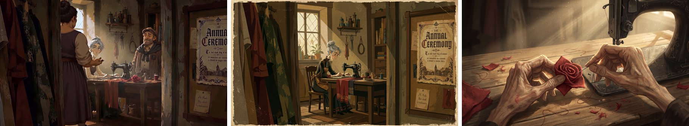

# 20 · Keep a Character Consistent Across Three Shots
[Docs page](https://flick.art/docs/character-consistency-three-shots)

One good image isn't enough. The character must look the **same in a wide, a medium and a close-up**.


**Wide:** she's small, so the **bun, dress and apron** make her recognizable. **Medium:** the **face and hair** become clear. **Close-up:** only hands and the rose, so the **aged hands and red fabric** must match.

## Rule 1: Each shot size needs different details to match
| Shot | What the viewer recognizes |
|---|---|
| Wide | Silhouette: clothes, hairstyle shape, props |
| Medium | Face + clothes |
| Close-up | Face shape, eyes, small details (a ring, a scar) |

So a matching costume alone is **not** enough for a close-up.

## Rule 2: Keep "who" and "what's happening" separate
Write the **identity once** and reuse it. Write a **new shot line** each time:
```
WHO (same every time): Aarav, 10, short messy black hair, mustard kurta, white pajama.
SHOT (changes): Wide — he kneels by the wall of diyas at dusk.
```

## Rule 3: A small checklist before more shots
| Thing | Must stay | Can change |
|---|---|---|
| Aarav | Face, hair, mustard kurta | Expression, angle |
| Diya | Clay shape, size | Lit / unlit |
| Matchbox | Red, small | In his hand / on the wall |

**Props that matter get their own close-up reference.**

## Rule 4: Compare side by side before animating
Check in this order: **face → hair → clothes → props**. Would a stranger say it's the same person?

## Rule 5: Fix one thing at a time
| Problem | Check first |
|---|---|
| Face changed | Is the face clear in the reference? Add a face close-up |
| Clothes changed | Remove clothing words that fight the reference |
| Whole look changed | Same model and style for every shot? |

Then test the **video** too. Motion can change the character again.

## Practice (~30 credits)
Using the Aarav sheet (from page 19), make 3 shots in a **new place**:
- Wide: *"He walks through a crowded Diwali market at night."*
- Medium: *"He holds a small paper lantern and smiles."*
- Close-up: *"His hands hold the glowing lantern."*
Put them side by side. Name one thing that drifted and one fix to try.
