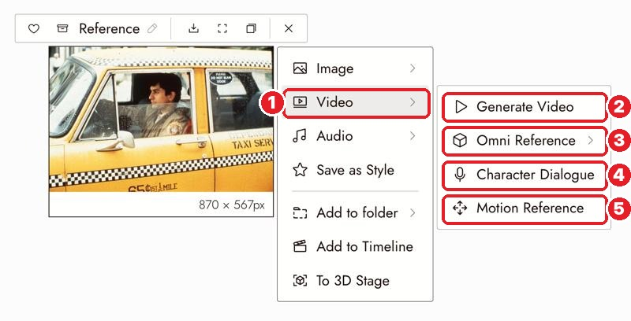

# 21 · Generate Video
[Docs page](https://flick.art/docs/video)

Turn a still into a moving clip. **Fix the still first**, then animate it.

## Where it is
Select the image → **1 Video ›**

| # | Action | Use it when |
|---|---|---|
| 2 | **Generate Video** | Animate this still (most common) |
| 3 | **Omni Reference** | Guide it with extra images, videos, audio *(page later)* |
| 4 | **Character Dialogue** | Make a character talk *(Audio section)* |
| 5 | **Motion Reference** | Copy movement from a video (e.g. a wave, a dance) |

Panel: [page 03](03-create-your-first-project.md#video-panel) · ⚠️ orange text = model changes your aspect ratio ([page 04](04-three-shot-story.md#where-things-are)).

## The motion prompt: 3 sentences
1. **What moves** (one action + a pace word)
2. **What the camera does** (or "static camera")
3. **What stays the same**

```
She turns her head slowly toward the window.
Static camera, locked framing.
Her face, the lighting and the framing stay the same.
```
Don't describe the whole scene again. The image already shows it.

## Settings
| Setting | Tip |
|---|---|
| Duration | **Shortest that fits the action.** Shorter = cheaper and more stable |
| Resolution | **Test low**, final high. Higher res won't fix a bad still |
| End Frame | Only for a clear change (sitting → standing). Optional |
| 1x | How many clips at once (cost multiplies) |

## Other video tools (on a video node)
| Tool | Does | Cost |
|---|---|---|
| **Trim** | Keep part of a clip as a new node | Free |
| **Extend Video** | Add footage after/before a clip | Standard plan+ |
| **Edit Video** | Change something in a clip ("make the wall blue tiles") | Credits |
| **Upscale Video** | Higher resolution | Credits |
| **Sound Effects** | Add synced sounds | Credits |

## Rules
1. **One clear action per clip.**
2. **Write a pace word:** slowly, gently.
3. **Small camera moves.** Big moves make the AI invent the scene.
4. **Watch the whole clip, especially the last second.**
5. **Keep the take that tells the story**, even if another looks prettier.

## If it's wrong
| Problem | Fix |
|---|---|
| Face changes | Shorter clip, less head movement, clearer face in the still |
| Too fast / wrong motion | One action + "slowly"; try another model |
| Things melt or drift | Less camera movement, or "static camera" |
| Nothing happens | Name who moves and describe a visible change |

## Practice (~20 credits)
Take **S2 Hands** (Last Diya) → Generate Video → **5s** → Take B from the docs' exercise: *"He holds still, looking at the flame. Slow push in toward his face. Nothing else changes."* Compare with your V2: camera move vs subject move.
