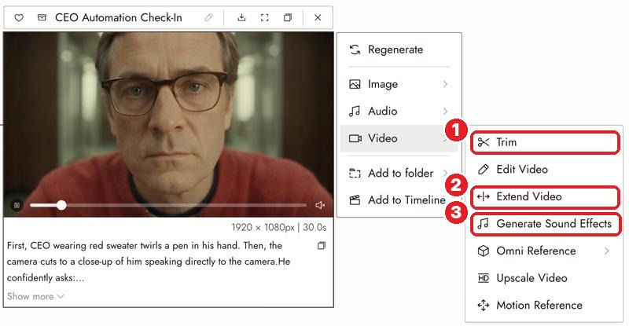
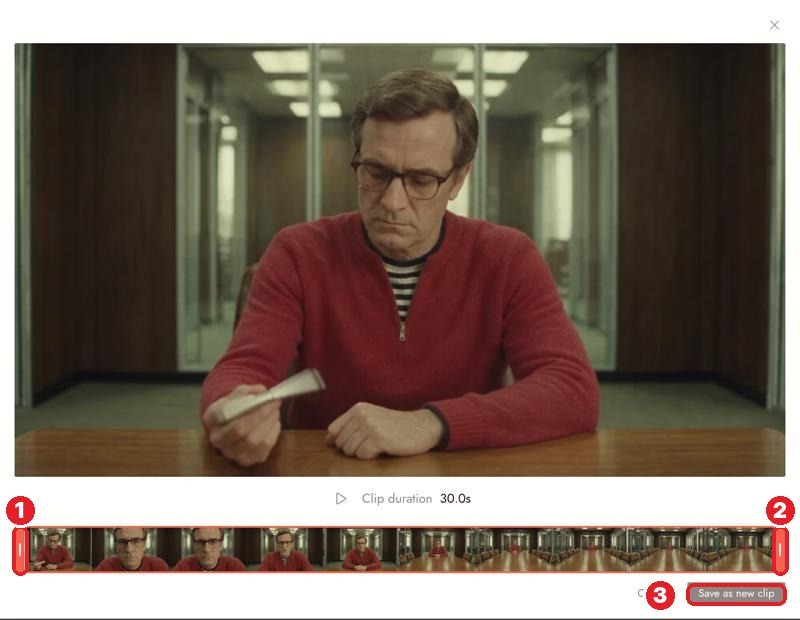

# 22 · Extend a Clip + Trim on the Canvas
Docs: [Extend a clip](https://flick.art/docs/extend-video) · [Trim a clip on the canvas](https://flick.art/docs/trim-on-canvas)

## Where they are
Select a **video** → **Video ›**

**1** Trim · **2** Extend Video · **3** Generate Sound Effects

## Trim (free)
Keep only the good part, as a **new clip**. The original never changes.

Drag **1** start grip and **2** end grip → **3** Save as new clip
Keys: `Space` play · `I` / `O` set start / end · `Enter` save · `Esc` cancel

**Use it to:** cut a bad last second, keep one beat of a long take, prepare a clip for Extend.

## Extend Video (Standard plan+)
Adds new footage **after** (or before) a clip you like. Same person, same light, no seam.

| Setting | Choose |
|---|---|
| Extend by | +2s up to 30s total |
| Direction | After / Before the clip |
| Prompt | **Only what happens next** |

```
she sets the cup down and looks out of the window
```
Limits: source clip ≤ 15s · total ≤ 30s · MP4/MOV ≤ 100 MB · ~12 credits/second at 720p, charged on the **whole** result (5s + 5s = 10s charged).

## Rules
1. **Trim before you extend** (cut the bad end first).
2. **Extend prompt = only the new action.** Describing the scene makes the model build a new one.
3. **Keep "Improve Prompt" on.**
4. **Free plan?** Use the old way: Extract Frame → **Last frame** → new video from it ([page 13](13-extract-frame.md)).

## Practice (free)
Trim **V3** (Boy with Glowing Diyas) to start at **2.5s**, the same fix you did in the editor, but as a new canvas clip.
