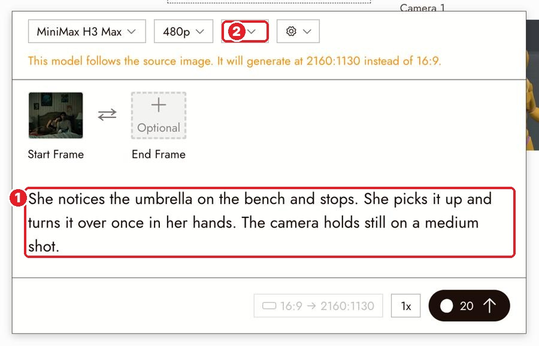

# 23 · Direct One Clear Action
[Docs page](https://flick.art/docs/direct-one-clear-action)

The key page for **motion prompts**.

## Two kinds of motion
| Subject motion | Camera motion |
|---|---|
| What people and things do | Where the viewer looks |
| She turns her head · the train arrives | Pan · tilt · push in · pull out · track · **static** |

Write them **separately**.

## The 3-sentence prompt

**1** the prompt · **2** shortest duration that fits

```
1. She looks up from her watch and slowly turns her head toward the red umbrella.   ← subject + pace
2. Static camera, locked framing.                                                    ← camera (one job)
3. The platform, the lighting and the framing stay the same.                         ← what stays
```
More than one step? Say the order: **"First… then…"**

## Duration
**Shortest that holds the action.** Extra seconds = extra unwanted movement. Trim the rest later.

## The 3-take test (best way to learn)
Same still, same model, same length:
| Take | Prompt | Watch for |
|---|---|---|
| A | Subject only + "static camera" | Does the action read? |
| B | "She holds still…" + one camera move | Does the camera do what you said? |
| C | Both together | Do they work together, or does it drift? |
Keep the take that **tells the story best**.

## When words fail
| You want | Use |
|---|---|
| A different angle (reverse shot) | **Change Angle** (a still, [page 18](18-camera-control.md)) |
| A clip to continue | **Extract Frame → Last frame** ([page 13](13-extract-frame.md)) or Extend |
| An exact camera move | Show it: **Motion Reference**, **Omni Reference** or **3D Stage** *(later pages)* |

## Rules
1. **One action + one camera move per clip.**
2. **Visible actions, not moods:** ❌ "act kindly" ✅ "she pauses and smiles"
3. **Camera moved when you said static?** Say it twice: "Static camera, locked framing."
4. **Action over in 1 second?** Add "slowly", add "first… then…", shorten the clip.
5. **New background appeared?** Make the camera move smaller.

## Practice (~60 credits)
Do the 3-take test on **S1 Wide** (Last Diya):
- A: *"The boy strikes a match slowly. Static camera, locked framing. Everything else stays the same."*
- B: *"The boy holds still. Slow push in toward him. Nothing else changes."*
- C: *"The boy strikes a match slowly while the camera pushes in slowly. Everything else stays the same."*
Which tells the story best?
