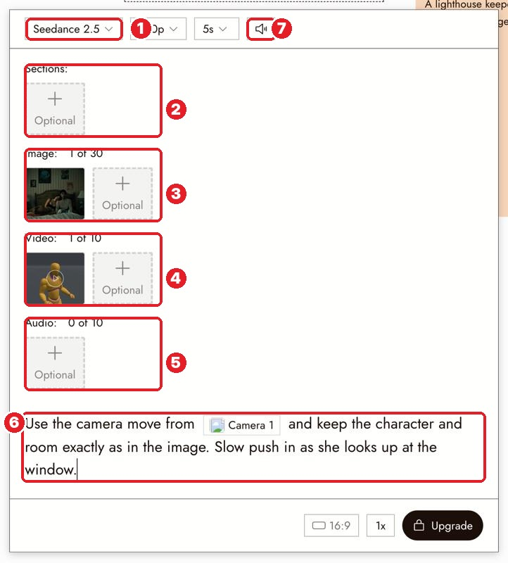
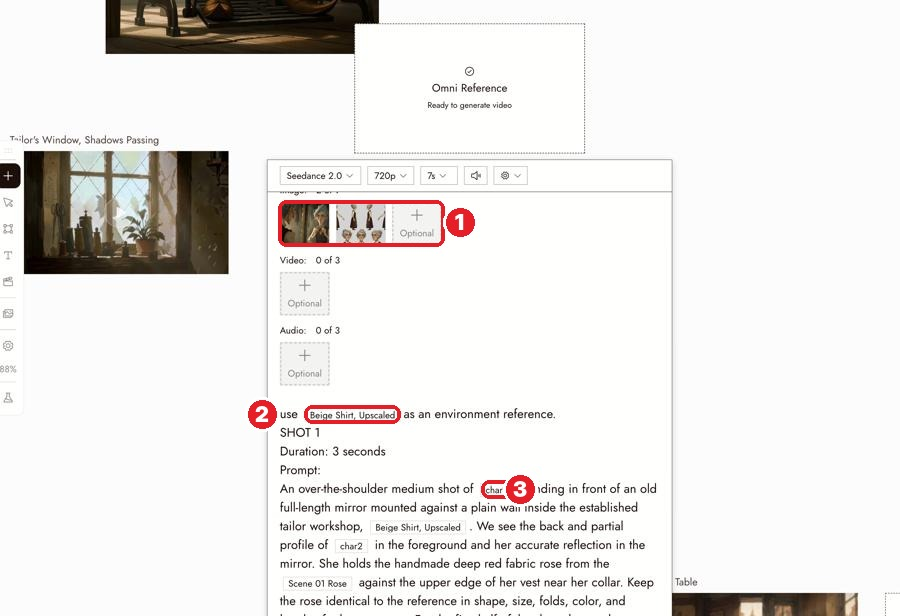

# 24 · Omni Reference
[Docs page](https://flick.art/docs/omni-reference)

Make a video from **several references at once**: who, where, how it moves, what is said. Needs a paid plan for Seedance.

## Where it is
Select the start image → **Video › Omni Reference** → pick a model family (Seedance, Kling, Wan, MiniMax, Gemini)

**1** model · **2** Sections (a whole section as reference) · **3** **Image** · **4** **Video** · **5** **Audio** · **6** prompt with `@` mentions · **7** sound on/off

## Give each reference ONE job
| You want to control | Attach |
|---|---|
| Who the character is | **Image**: character sheet or face close-up |
| The place | **Image**: location still |
| The first frame | A finished still (start frame, if the model has one) |
| Camera move / body movement | **Video**: a 3D Stage take, a Blender render, or real footage you own |
| What is said + lip sync | **Audio**: the voice line |

## The prompt: name every reference
```
Keep the character from @Image1 and the room from @Image2.
Use the camera move from @Video1 only.
Slow push in as she looks up at the window.
```
A reference **not mentioned** in the prompt may be **ignored**.

A pro example (Happy Souls Alive):

**1** two images attached · **2** "use [Beige Shirt] as an environment reference" · **3** "[char2]" = the character, mentioned by name

## Rules
1. **One job per reference**, and say the job in the prompt.
2. **Mention every reference with `@`.**
3. **The references carry the look; the prompt says what happens.**
4. **Render a good start frame first** (still image), then let the video reference add only the movement.
5. **Limits differ per model** (how many images/videos/audio). The panel shows the count.

## If it's wrong
| Problem | Fix |
|---|---|
| Camera move ignored | Mention @Video1 and say what to take: "camera move and blocking". Shorten the clip |
| Character changed | Clearer sheet; "keep the character from @Image1 100%" |
| First frame doesn't match | Check the model has a Start Frame slot; Seedance uses images as guides only |

## Practice (paid plan, ~100+ credits)
Record yourself on your phone slowly raising one arm (3 seconds). Upload it.
Omni Reference → @Image1 = **Arjuna Sheet**, @Video1 = your phone clip →
*"Arjuna's appearance matches @Image1 100%. Use @Video1 only for the arm movement and timing. He slowly raises his bow toward the sky. Static camera."*
