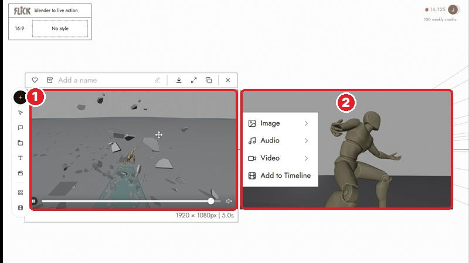
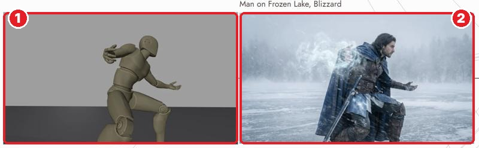
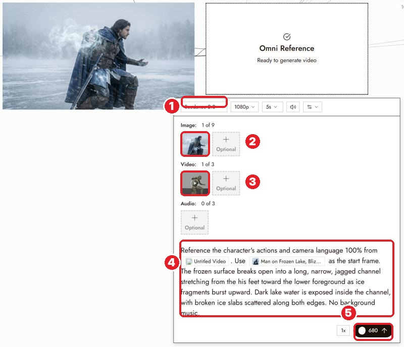

# 26 · Blender to AI Clip
[Docs page](https://flick.art/docs/blender-to-ai-clip)

Plan the **movement and camera** in Blender (free 3D software) with a simple mannequin, then let Flick turn it into a **real-looking** clip.

⏭ **Optional:** only if you know Blender. Flick's own **3D Stage** (next section) does the same thing inside Flick, without extra software.

## The 3 steps
**1. Upload 2 files from Blender:** the animation video + its **first frame** as an image.

**1** the Blender video · **2** its first frame

**2. Give the first frame the final look** (Edit & Merge with Nano Banana):

**1** grey mannequin → **2** a real warrior on a frozen lake
```
Give this frame realistic materials and soft daylight.
Keep the camera angle, framing, subject positions and poses unchanged.
```

**3. Omni Reference → Seedance** with both files:

**1** model · **2** Image = the styled frame (the **look**) · **3** Video = the Blender clip (the **movement**) · **4** prompt naming both · **5** cost (680 for 1080p, 5s)

```
Use @Image1 for the character's appearance, materials and lighting.
Follow the character action and camera movement in @Video1.
```

## Rules
1. **The image gives the look; the video gives the movement.**
2. **First frame must match the video's first frame** (same crop, same pose).
3. **One clear action** for your first test.
4. **Check the styled frame before generating video.** Pose or layout changed? Fix the still first.
5. **Test at low resolution.** 1080p Seedance is expensive.

## Practice
No Blender? Skip this one. You'll do the same thing with the **3D Stage** in the 3D section.
