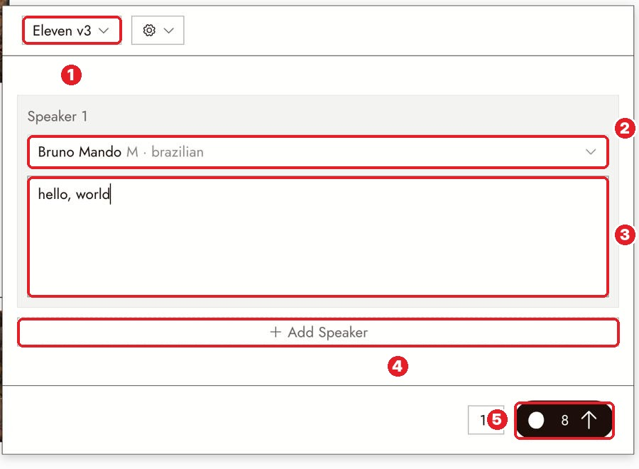
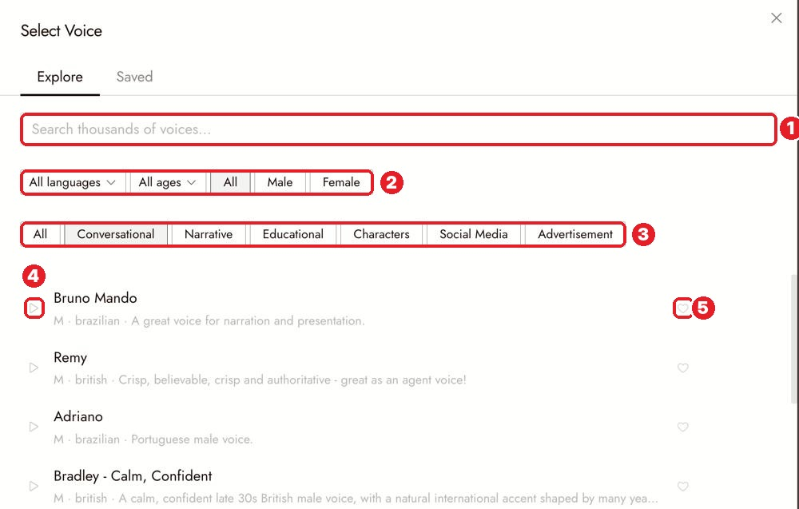

# 28 · Text to Voice
[Docs page](https://flick.art/docs/text-to-voice)

Turn written lines into a spoken voice. You used this for the Gita narration.

## Where it is
**+ → Generate Voice** (or select a character image → **Audio › Generate Voice**, which links the voice to that character).

**1** model (Eleven v3/v4, Seed Audio) · **2** voice for Speaker 1 · **3** the lines · **4** + Add Speaker (up to 10) · **5** cost (~8)

## Pick a voice (free to preview)

**1** search · **2** language, age, male/female · **3** use (Narrative, Characters…) · **4** ▶ **hover to preview** · **5** ♡ save for later (Saved tab)

## Write lines the way they're spoken
- **Short sentences.** Punctuation = pauses.
- **Cues in brackets:** `[whispers]` · `[softly]` · `[slowly]` · `[laughs]` · `[sighs]` · `[dramatic pause]`
- **Numbers as words:** "two a.m."
- **Hindi/Sanskrit words:** spell them the way they sound ("Karmanye vaadhikaaraste").

Several speakers (Eleven v3/v4): write each speaker's lines in their own box → **+ Add Speaker** → one audio file of the whole talk.

**Your own voice as a reference:** model **Seed Audio 1.0** → attach up to 3 audio/video clips → mention them as `@Audio1`.

## Rules
1. **Preview before you generate.** Hovering is free.
2. **Long narration in ONE run.** It's cheaper, and the voice stays the same.
3. **One voice per character, forever.** ♡ save it.
4. **Check the cost again** after pasting long text.

## Check
- [ ] No missing or repeated words
- [ ] Bracket words were **not** spoken aloud
- [ ] Pauses where the punctuation is
- [ ] A whisper sounds like a whisper

## If it's wrong
| Problem | Fix |
|---|---|
| Flat delivery | Shorter sentences, more punctuation, a bracket cue |
| Wrong pronunciation | Spell the word the way it sounds |
| Two characters sound the same | Pick clearly different voices; write down who is who |

## Practice (~8 credits)
Arjuna and Krishna, 2 speakers, Eleven v4:
- **Speaker 1 (Arjuna):** `[softly] Krishna... I cannot do this.`
- **Speaker 2 (Krishna):** `[calm] Rise, Arjuna. Do your duty.`
Do the two voices feel like two different people?
